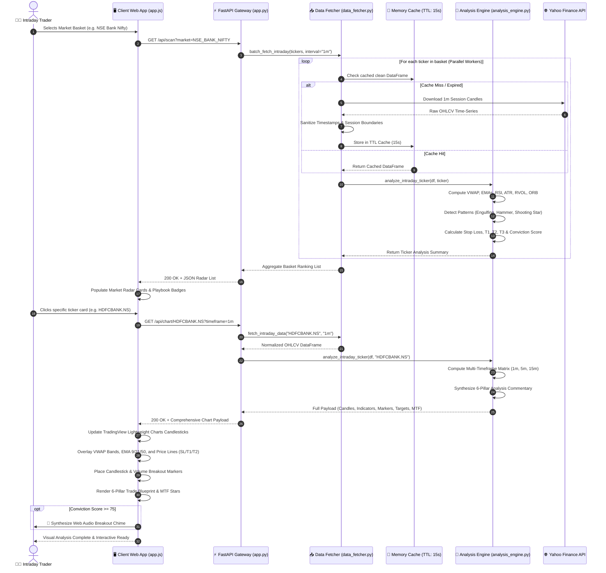

# Apex Intraday Trading Terminal 📈⚡

An institutional-grade **Intraday Technical Screener & Interactive Chart Analysis Terminal** powered by real-time 1-minute data from Yahoo Finance.

Built specifically for active intraday traders to automatically identify high-probability momentum setups, calculate dynamic volatility-adjusted Stop Loss & Target prices, and provide comprehensive chart analysis rationales.

---

## 🌟 Key Highlights & Features

### 1. 🔍 High-Probability Intraday Screener
- **Institutional Scoring Engine (-100 to +100)**: Evaluates trend structure, volume confirmation, oscillator momentum, and breakout dynamics into a normalized 0–100 Intraday Conviction Score.
- **Automated Trade Categorization**:
  - `STRONG BUY` / `BUY` (Long momentum)
  - `NEUTRAL / CONSOLIDATION` (Range-bound)
  - `SELL` / `STRONG SELL` (Short momentum)
- **Playbook Setup Classification & Quick Filters**:
  - *Day-High Momentum Breakout*
  - *15-Min Opening Range Breakout (ORB High / Low)*
  - *Bullish VWAP Reclaim*
  - *EMA 9/21 Trend Continuation Bounce*
  - *High RVOL Volume Spikes (>1.5x - 3.0x)*
- **Preconfigured Market Baskets**:
  - 🇮🇳 **NSE Nifty 50 Momentum**: Top liquid Nifty leaders
  - 🏦 **NSE Bank Nifty Leaders**: High-beta banking stocks (`HDFCBANK.NS`, `ICICIBANK.NS`, `SBIN.NS`, `BANKBARODA.NS`, `AXISBANK.NS`, etc.)
  - 💻 **NSE Nifty IT Leaders**: Tech giants (`TCS.NS`, `INFY.NS`, `HCLTECH.NS`, `WIPRO.NS`, `TECHM.NS`, `LTIM.NS`)
  - 🇺🇸 **US Magnificent 7**: `NVDA`, `TSLA`, `AAPL`, `MSFT`, `AMZN`, `META`, `GOOGL`
  - 🇺🇸 **US High-Beta Movers**: `AMD`, `PLTR`, `COIN`, `NFLX`, `SMCI`, `ARM`, `MARA`
  - ⚡ **Custom Watchlist**: Real-time scan of any custom list of global tickers.

### 2. 📊 Interactive Candlestick Chart with Pattern Detection
- **High-Performance 1-Minute Live Candlesticks** via TradingView's Lightweight Charts engine.
- **Automated Candlestick Pattern Recognition & Visual Markers**:
  - 🟢 **Bullish Engulfing** & 🔨 **Hammer Reversal**: Visual icons below candles at key support/VWAP.
  - 🔴 **Bearish Engulfing** & ☄️ **Shooting Star**: Visual icons above candles at resistance.
  - ⚡ **Institutional Volume Breakout Bars**: Arrow markers tagged with the exact RVOL multiplier (e.g. `BREAKOUT (2.3x)`).
- **Overlay Indicators**:
  - **VWAP (Volume Weighted Average Price)** with daily session reset & standard deviation bands.
  - **EMA Ribbon**: 9 EMA (Fast trigger), 21 EMA (Trend base), 50 EMA (Structural trend).
  - **Volume & 20-period Volume Moving Average**: Color-coded volume bars.
  - **RSI (14)** Sub-chart with 70 Overbought, 50 Midline, and 30 Oversold guides.
- **Visual Trade Price Lines Plotted Directly on the Chart**:
  - 🛑 **Stop Loss (Red dashed line)** with price & percentage risk
  - 🎯 **Target 1 (Green dashed line)** at 1:1.5 Risk-Reward ratio
  - 🚀 **Target 2 (Cyan dashed line)** at 1:2.5 Risk-Reward ratio
  - 📍 **Entry Price (Amber dotted line)**
  - Dynamic crosshairs & floating legend displaying real-time candle metrics.

### 3. 🎯 Multi-Timeframe (MTF) Alignment Matrix
- Computes trend confluence across **1-Minute (Trigger)**, **5-Minute (Tactical)**, and **15-Minute (Macro)** timeframes.
- Institutional Confluence Rating:
  - ⭐⭐⭐ **3/3 High Conviction**: Full alignment across all 3 timeframes (maximum probability setup).
  - ⭐⭐ **2/3 Good Confluence**: Directional alignment with pullback entry opportunity.
  - ⚠️ **1/3 Low Confluence**: Mixed/choppy price action.

### 4. ▶ Bar-by-Bar Session Replay Simulator
- Built-in session backtesting player: step forward or stream past sessions bar-by-bar (1x, 3x, 5x speed) to review exactly how setups and breakouts evolved during market hours.

### 5. 🔔 Audio Alerts & 📋 One-Click Trade Plan Export
- Synthesized Web Audio alert chime whenever high-conviction breakout signals trigger.
- One-click **Copy Setup** button formats the entire trade plan for instant sharing to trading journals or messaging apps.

### 3. 🎯 Day Stop Loss & Target Engine
- **Volatility-Adjusted Risk Rules**:
  - Computes 14-period 1-minute **Average True Range (ATR)**.
  - Anchors Stop Loss structurally behind the lowest low of recent 10 candles and VWAP buffer.
  - Ensures intraday risk is realistic (0.3% to 1.5% max risk per trade).
- **Multi-Target Scaling**:
  - **Target 1**: 1:1.5 Risk-Reward (Scalp / 50% partial profit booking level).
  - **Target 2**: 1:2.5 Risk-Reward (Main Day Target / Day High test).
  - **Target 3**: 1:3.5 Risk-Reward (Trend runner).
  - Explicit trailing rules: "Book 50% at Target 1, trail Stop Loss to Cost/Entry, ride remaining to Target 2."

### 4. 🧠 6-Pillar Technical Chart Analysis Rationale
Provides clear institutional commentary explaining *why* the stock was chosen:
1. **Trend & VWAP Structure**: Distance from VWAP, slope, and EMA ribbon alignment.
2. **Institutional Volume Flow**: Relative Volume (RVOL) multiplier and volume surge confirmation.
3. **Price Action & Range**: 15-Minute Opening Range (ORB) and Day High/Low proximity.
4. **Momentum Oscillators**: RSI sweetspot (55–72) evaluation without overextension.
5. **Volatility & Stop Loss Rule**: Precise ATR calculation and structural invalidation level.
6. **Target Projections**: Mathematical risk multiple targets and key resistance levels.

### 5. 🧮 Intraday Position Sizing Calculator
- Live interactive calculator: Enter trading capital and max risk percentage (e.g. 1%), and the terminal instantly calculates the exact number of shares to trade, max capital at risk, and potential gains.

---

## 🚀 Quick Start Guide

### 1. Launch the Application
Run the startup script:
```bash
./start.sh
```
Or with uvicorn:
```bash
.venv/bin/uvicorn app:app --host 0.0.0.0 --port 8000 --reload
```

### 2. Access the Web Terminal
Open your browser and navigate to:
```
http://localhost:8000
```

---

## 🏛️ Technical Architecture

### 1. High-Level System Architecture

The following diagram illustrates the high-level system boundary, showing how user interactions in the browser communicate through the FastAPI application gateway to the quant analysis pipeline and upstream market data feeds:

```mermaid
flowchart TD
    subgraph ClientLayer["🖥️ Presentation Layer (Trader Workstation)"]
        UI["Modern 3-Pane Trading UI\n(Responsive, Dark/Light Themes, Mobile-Ready)"]
        TVC["TradingView Lightweight Charts Engine\n(1-Min Live Candlesticks, Overlays, Sub-Panes)"]
        Replay["Session Replay Simulator\n(Bar-by-Bar Step & Stream Playback)"]
        AudioEngine["Web Audio API Synthesizer\n(Zero-Asset Breakout Sound Chimes)"]
        PosCalc["Interactive Position Sizing Calculator\n(Capital Risk & Trade Management)"]
    end

    subgraph GatewayLayer["⚡ Backend Application Gateway (FastAPI / Uvicorn)"]
        Router["FastAPI REST Router\n(/api/scan, /api/chart, /api/market-status, /api/custom-scan)"]
        StaticServer["Static Files Server\n(HTML5, CSS3, ES6 JavaScript, Local Chart Bundles)"]
        SessionClock["Exchange Session Monitor\n(NSE 09:15-15:30 IST / US 09:30-16:00 EST)"]
    end

    subgraph QuantLayer["🧠 Quantitative & Data Processing Engine"]
        DataFetcher["Parallel Data Acquisition Module\n(ThreadPoolExecutor & 15s In-Memory TTL Cache)"]
        IndicatorPipeline["Indicator Calculation Engine\n(VWAP + SD Bands, EMA 9/21/50, RSI 14, ATR 14, RVOL)"]
        PatternRecognizer["Candlestick & Volume Pattern Detector\n(Engulfing, Hammers, Shooting Stars, Breakouts)"]
        RiskManager["Structural Risk & Target Synthesizer\n(ATR Swing Stop Loss, Target 1/2/3, Trailing Rules)"]
        MTFConfluence["Multi-Timeframe Alignment Engine\n(1m Trigger, 5m Tactical, 15m Macro Trend Matrix)"]
        ScoreEngine["Institutional Conviction Scoring\n(-100 to +100 Scale & 6-Pillar Narrative Generator)"]
    end

    subgraph DataProviderLayer["🌐 External Market Data Infrastructure"]
        YF["Yahoo Finance API\n(Real-time 1m, 5m, 15m OHLCV Tick & Candle Stream)"]
    end

    ClientLayer <-->|Async HTTP REST / JSON Polling (10s)| GatewayLayer
    GatewayLayer -->|Dispatches Scan & Analysis Tasks| QuantLayer
    QuantLayer <-->|Multi-Threaded Requests & Normalized Dataframes| DataProviderLayer
```

---

### 2. Low-Level Component Architecture

The detailed component diagram below maps out internal class modules, functions, state variables, and directional data pathways between the frontend controllers and backend calculation pipelines:

```mermaid
flowchart TD
    subgraph FrontendArchitecture["🎨 Client-Side Layer (static/app.js & static/index.html)"]
        subgraph ViewPanes["UI Presentation Panes"]
            RadarPane["Market Radar (Left Pane)\n- Momentum Screener Cards\n- Conviction Gauges (0-100)\n- Setup Playbook Badges\n- RVOL Multiplier Indicators"]
            ChartViewport["Chart Canvas (Center Pane)\n- Candlestick Series (Lightweight Charts)\n- VWAP Line + Upper/Lower SD Bands\n- EMA Ribbon (9, 21, 50 Periods)\n- Structural SL & Target Price Lines\n- Interactive Pattern Markers Layer\n- RSI(14) Sub-Pane & Volume Histogram\n- Zoom Controls & Crosshair Synchronizer"]
            BlueprintPane["Trade Blueprint (Right Pane)\n- Setup Summary & Entry Parameters\n- Risk/Reward Multi-Target Matrix\n- 6-Pillar Technical Rationale Breakdown\n- MTF Confluence Matrix (1m / 5m / 15m)\n- Real-Time Position Sizing Calculator\n- One-Click Clipboard Trade Exporter"]
        end

        subgraph ClientControllers["Client State & Controller Logic (app.js)"]
            StateStore["Terminal State Store\n- currentMarketBasket\n- currentTicker\n- currentTimeframe\n- replayState (barIndex, isPlaying)\n- activeTheme (dark/light)"]
            PollingService["Auto-Refresh Polling Daemon\n- 10-second Tick Cycle\n- Tab Visibility Detection\n- Manual Refresh Hook"]
            ChartManager["Chart Rendering Controller\n- initChart() & resizeObserver()\n- setMarkers(detectedPatterns)\n- plotHorizontalPriceLines()"]
            ReplayController["Session Replay State Machine\n- stepForward() / stepBackward()\n- playReplay() at 1x, 3x, 5x Speed\n- streamBarSlice()"]
            AudioDispatcher["Synthesized Audio Dispatcher\n- Web Audio AudioContext\n- GainNode & Oscillator Frequency Ramps"]
        end

        PollingService -->|Trigger Poll| StateStore
        StateStore -->|Fetch Active Basket| RadarPane
        RadarPane -->|On Card Click| StateStore
        StateStore -->|Load Ticker Dataset| ChartManager
        ChartManager --> ChartViewport
        ChartViewport -->|Update Selection| BlueprintPane
        ReplayController -->|Slice Candlesticks| ChartManager
        StateStore -->|Strong Conviction Filter| AudioDispatcher
    end

    subgraph BackendGateway["🚀 FastAPI Application Layer (app.py)"]
        Router_Scan["GET /api/scan\n- Filters by market basket\n- Parallel batch evaluation\n- Returns sorted conviction rankings"]
        Router_Chart["GET /api/chart/{ticker}\n- Ingests ticker & timeframe (1m/5m/15m)\n- Returns OHLCV + Indicators + Risk Model"]
        Router_Market["GET /api/market-status\n- Exchange clock checks for NSE & US\n- Session open/closed flags & countdowns"]
        Router_Custom["GET /api/custom-scan\n- Dynamic user watchlist parsing\n- Concurrency-throttled batch analysis"]
        Router_Watchlists["GET /api/watchlists\n- Pre-curated institutional universes\n- Nifty 50, Bank Nifty, IT, Mag 7, High Beta"]
    end

    subgraph DataFetcherEngine["📥 Data Acquisition Layer (data_fetcher.py)"]
        FetcherAPI["fetch_intraday_data(ticker, interval, period)\n- yfinance.Ticker.history() query\n- Exchange timezone normalization\n- Cleaning NaNs & zero-volume gaps"]
        BatchFetcher["batch_fetch_intraday(tickers, interval)\n- ThreadPoolExecutor(max_workers=8)\n- Asynchronous concurrent futures"]
        MemoryCache["Thread-Safe In-Memory Cache\n- 15-second TTL per ticker/interval\n- Prevents rate-limits & reduces latency"]
        MarketHours["is_market_open(market_key)\n- Timezone calculation (Asia/Kolkata, US/Eastern)\n- Holiday & weekend boundary verification"]
    end

    subgraph QuantitativeEngine["🧠 Quantitative Math & Signal Engine (analysis_engine.py)"]
        subgraph IndicatorMath["Indicator Mathematical Computations"]
            CalcVWAP["VWAP & SD Bands Engine\n- Typical Price: (H + L + C) / 3\n- Cumulative PV / Cumulative V\n- 1st & 2nd Standard Deviation bands"]
            CalcEMA["EMA Ribbon Pipeline\n- Fast: 9-period EMA (Alpha = 2/10)\n- Base: 21-period EMA (Alpha = 2/22)\n- Structural: 50-period EMA (Alpha = 2/51)"]
            CalcRSI["RSI(14) Oscillator\n- Wilder Exponential Smoothing\n- Average Gains & Average Losses\n- Overbought(70) / Oversold(30)"]
            CalcATR["ATR(14) Volatility Engine\n- True Range: Max(H-L, |H-Cp|, |L-Cp|)\n- Smoothed Intraday Volatility Gauge"]
            CalcRVOL["Relative Volume (RVOL) Engine\n- 20-period Volume Simple Moving Average\n- Ratio: Current Bar Volume / Vol SMA\n- Spike Thresholds: 1.5x, 2.0x, 3.0x"]
            CalcORB["15-Minute Opening Range (ORB)\n- Session High & Low of first 15 bars\n- Breakout detection with volume bias"]
        end

        subgraph PatternEngine["Pattern Recognition & Multi-Timeframe Alignment"]
            CandleModel["Candlestick Pattern Recognition\n- Bullish/Bearish Engulfing Detection\n- Hammer & Inverted Hammer Formation\n- Shooting Star Reversal Detector\n- High-Volume Institutional Expansion Bar"]
            MTFModel["Multi-Timeframe Confluence Engine\n- 1-Minute Trigger Alignment\n- 5-Minute Tactical Resample & Trend\n- 15-Minute Macro Directional Bias\n- Score Confluence: 3/3, 2/3, 1/3 Stars"]
        end

        subgraph RiskRationaleEngine["Risk Management & Rationale Synthesis"]
            RiskModel["Structural Stop Loss & Target Engine\n- Swing Low/High anchor + (0.5 * ATR buffer)\n- Target 1 (1:1.5 RR - Scalp / 50% Book)\n- Target 2 (1:2.5 RR - Main Day Target)\n- Target 3 (1:3.5 RR - Runner Target)\n- Trailing Stop Rules & Profit Guidance"]
            ScoringModel["Institutional Conviction Scoring (-100 to +100)\n- Trend & VWAP: 30% Weight\n- Volume & RVOL: 25% Weight\n- Momentum & RSI: 20% Weight\n- Price Action & ORB: 15% Weight\n- Candlestick Patterns: 10% Weight"]
            RationaleModel["6-Pillar Rationale Generator\n- Generates institutional markdown commentary\n- Explains exact trigger rationale to traders"]
        end
    end

    FrontendArchitecture <-->|HTTP REST Requests (JSON)| BackendGateway
    BackendGateway -->|Batch Data Needs| DataFetcherEngine
    DataFetcherEngine --> MemoryCache
    MemoryCache -->|Cache Miss| BatchFetcher
    BatchFetcher --> FetcherAPI
    FetcherAPI -->|Normalized Dataframes| QuantitativeEngine
    QuantitativeEngine --> IndicatorMath
    IndicatorMath --> PatternEngine
    PatternEngine --> RiskRationaleEngine
    RiskRationaleEngine -->|Constructed Trade Payload| BackendGateway
```

---

### 3. End-to-End Execution Sequence Flow

The following sequence diagram walks through the chronological lifecycle of a live scan and chart analysis query:



---

## 🛠 File & Directory Organization

```
ApexIntranet/
├── app.py                   # FastAPI backend with REST endpoints & market session monitors
├── analysis_engine.py       # Intraday indicator math (VWAP, EMA, RSI, ATR, RVOL, SL & Targets)
├── data_fetcher.py          # Parallel Yahoo Finance 1-min data scraper & memory cache
├── start.sh                 # One-click startup shell script
├── requirements.txt         # Python package dependencies
├── .gitignore               # Python and environment exclusion rules
└── static/
    ├── index.html           # Modern 3-pane institutional trading terminal UI
    ├── style.css            # Dark/Light responsive stylesheet with custom scrollbars
    ├── app.js               # Client controller, charting logic & interactive calculator
    └── lightweight-charts.js# TradingView Lightweight Charts library (v4.2.1)
```

