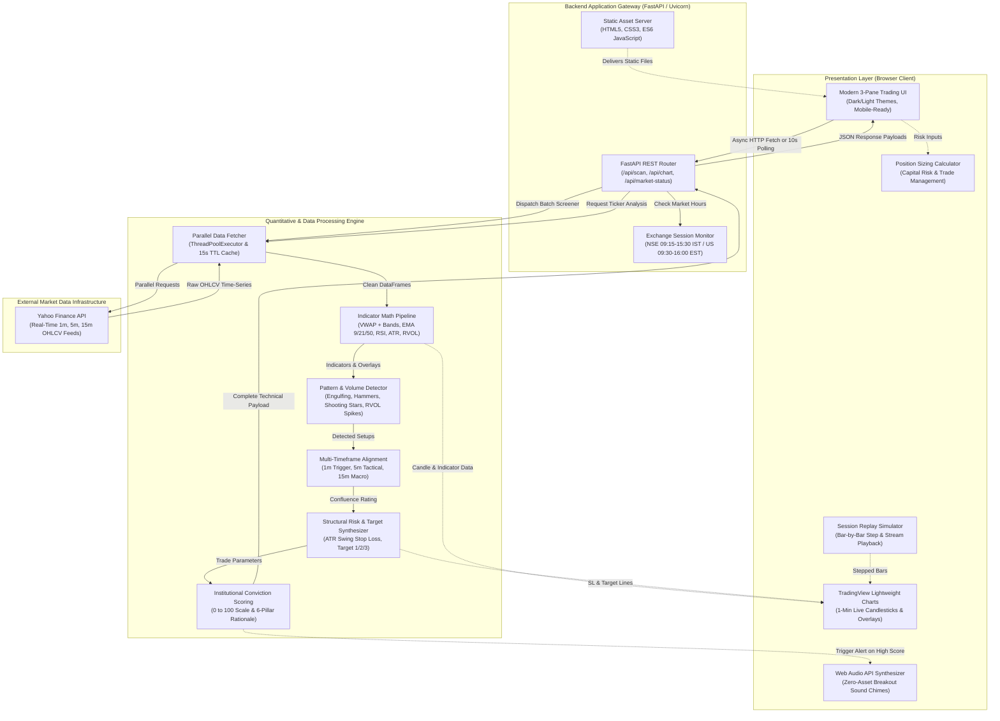
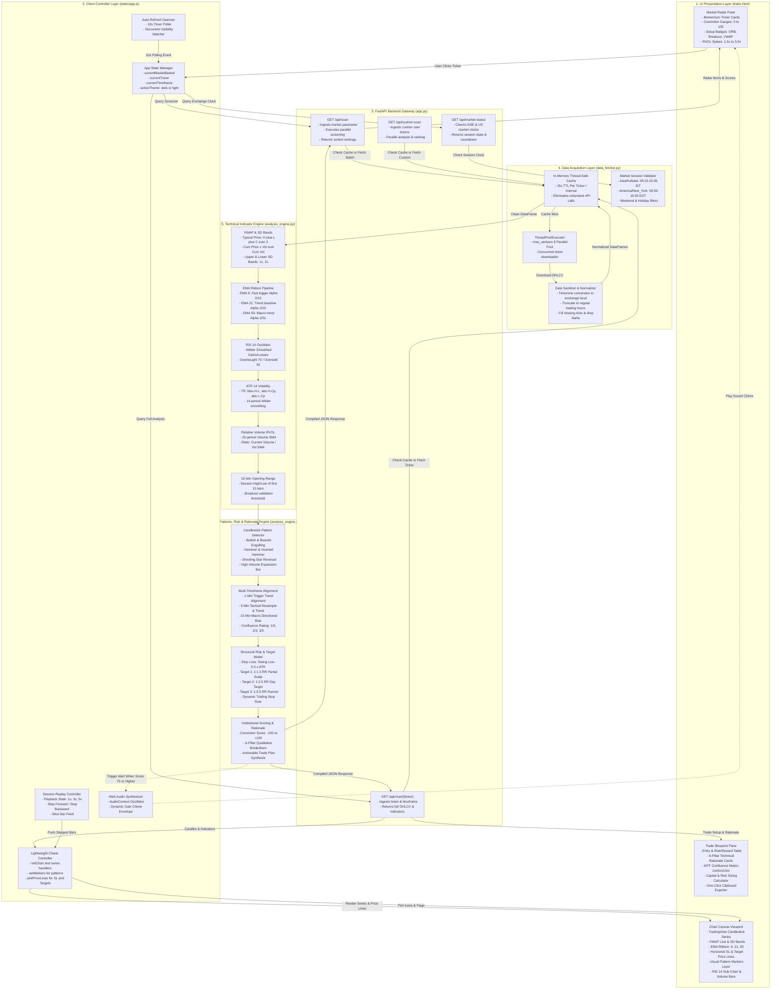
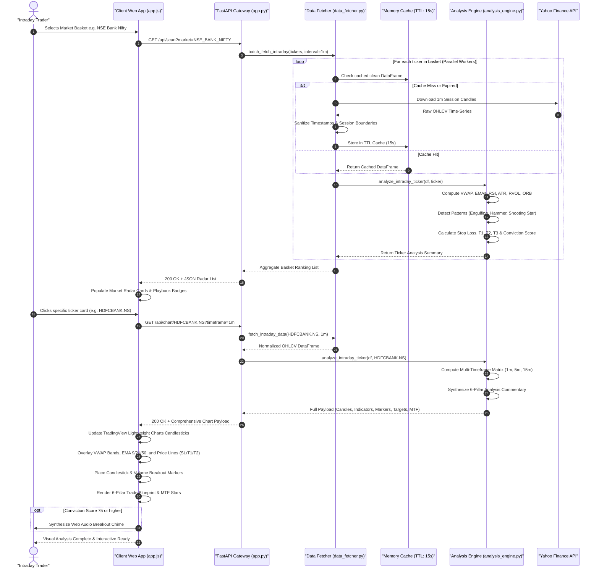

# Intraday Stock Picker 📈⚡

An institutional-grade **Intraday Technical Screener & Stock Picker Terminal** powered by real-time 1-minute data from Yahoo Finance.

Built specifically for active intraday traders to automatically identify high-probability momentum setups, calculate dynamic volatility-adjusted Stop Loss & Target prices, and provide comprehensive chart analysis rationales.

---

## 🌟 Key Highlights & Features

### 1. 🔍 High-Probability Intraday Screener
- **Institutional Scoring Engine (-100 to +100)**: Evaluates trend structure, volume confirmation, oscillator momentum, and breakout dynamics into a normalized 0–100 Intraday Conviction Score.
- **Automated Trade Categorization**:
  - `STRONG BUY` / `BUY` (Long momentum)
  - `NEUTRAL / CONSOLIDATION` (Range-bound)
  - `SELL` / `STRONG SELL` (Short momentum)
- **Playbook Setup Classification & Quick Filters**:
  - *Day-High Momentum Breakout*
  - *15-Min Opening Range Breakout (ORB High / Low)*
  - *Bullish VWAP Reclaim*
  - *EMA 9/21 Trend Continuation Bounce*
  - *High RVOL Volume Spikes (>1.5x - 3.0x)*
- **Preconfigured Market Baskets**:
  - 🇮🇳 **NSE Nifty 50 Momentum**: Top liquid Nifty leaders
  - 🏦 **NSE Bank Nifty Leaders**: High-beta banking stocks (`HDFCBANK.NS`, `ICICIBANK.NS`, `SBIN.NS`, `BANKBARODA.NS`, `AXISBANK.NS`, etc.)
  - 💻 **NSE Nifty IT Leaders**: Tech giants (`TCS.NS`, `INFY.NS`, `HCLTECH.NS`, `WIPRO.NS`, `TECHM.NS`, `LTIM.NS`)
  - 🇺🇸 **US Magnificent 7**: `NVDA`, `TSLA`, `AAPL`, `MSFT`, `AMZN`, `META`, `GOOGL`
  - 🇺🇸 **US High-Beta Movers**: `AMD`, `PLTR`, `COIN`, `NFLX`, `SMCI`, `ARM`, `MARA`
  - ⚡ **Custom Watchlist**: Real-time scan of any custom list of global tickers.

### 2. 📊 Interactive Candlestick Chart with Pattern Detection
- **High-Performance 1-Minute Live Candlesticks** via TradingView's Lightweight Charts engine.
- **Automated Candlestick Pattern Recognition & Visual Markers**:
  - 🟢 **Bullish Engulfing** & 🔨 **Hammer Reversal**: Visual icons below candles at key support/VWAP.
  - 🔴 **Bearish Engulfing** & ☄️ **Shooting Star**: Visual icons above candles at resistance.
  - ⚡ **Institutional Volume Breakout Bars**: Arrow markers tagged with the exact RVOL multiplier (e.g. `BREAKOUT (2.3x)`).
- **Overlay Indicators**:
  - **VWAP (Volume Weighted Average Price)** with daily session reset & standard deviation bands.
  - **EMA Ribbon**: 9 EMA (Fast trigger), 21 EMA (Trend base), 50 EMA (Structural trend).
  - **Volume & 20-period Volume Moving Average**: Color-coded volume bars.
  - **RSI (14)** Sub-chart with 70 Overbought, 50 Midline, and 30 Oversold guides.
- **Visual Trade Price Lines Plotted Directly on the Chart**:
  - 🛑 **Stop Loss (Red dashed line)** with price & percentage risk
  - 🎯 **Target 1 (Green dashed line)** at 1:1.5 Risk-Reward ratio
  - 🚀 **Target 2 (Cyan dashed line)** at 1:2.5 Risk-Reward ratio
  - 📍 **Entry Price (Amber dotted line)**
  - Dynamic crosshairs & floating legend displaying real-time candle metrics.

### 3. 🎯 Multi-Timeframe (MTF) Alignment Matrix
- Computes trend confluence across **1-Minute (Trigger)**, **5-Minute (Tactical)**, and **15-Minute (Macro)** timeframes.
- Institutional Confluence Rating:
  - ⭐⭐⭐ **3/3 High Conviction**: Full alignment across all 3 timeframes (maximum probability setup).
  - ⭐⭐ **2/3 Good Confluence**: Directional alignment with pullback entry opportunity.
  - ⚠️ **1/3 Low Confluence**: Mixed/choppy price action.

### 4. ▶ Bar-by-Bar Session Replay Simulator
- Built-in session backtesting player: step forward or stream past sessions bar-by-bar (1x, 3x, 5x speed) to review exactly how setups and breakouts evolved during market hours.

### 5. 🔔 Audio Alerts & 📋 One-Click Trade Plan Export
- Synthesized Web Audio alert chime whenever high-conviction breakout signals trigger.
- One-click **Copy Setup** button formats the entire trade plan for instant sharing to trading journals or messaging apps.

### 3. 🎯 Day Stop Loss & Target Engine
- **Volatility-Adjusted Risk Rules**:
  - Computes 14-period 1-minute **Average True Range (ATR)**.
  - Anchors Stop Loss structurally behind the lowest low of recent 10 candles and VWAP buffer.
  - Ensures intraday risk is realistic (0.3% to 1.5% max risk per trade).
- **Multi-Target Scaling**:
  - **Target 1**: 1:1.5 Risk-Reward (Scalp / 50% partial profit booking level).
  - **Target 2**: 1:2.5 Risk-Reward (Main Day Target / Day High test).
  - **Target 3**: 1:3.5 Risk-Reward (Trend runner).
  - Explicit trailing rules: "Book 50% at Target 1, trail Stop Loss to Cost/Entry, ride remaining to Target 2."

### 4. 🧠 6-Pillar Technical Chart Analysis Rationale
Provides clear institutional commentary explaining *why* the stock was chosen:
1. **Trend & VWAP Structure**: Distance from VWAP, slope, and EMA ribbon alignment.
2. **Institutional Volume Flow**: Relative Volume (RVOL) multiplier and volume surge confirmation.
3. **Price Action & Range**: 15-Minute Opening Range (ORB) and Day High/Low proximity.
4. **Momentum Oscillators**: RSI sweetspot (55–72) evaluation without overextension.
5. **Volatility & Stop Loss Rule**: Precise ATR calculation and structural invalidation level.
6. **Target Projections**: Mathematical risk multiple targets and key resistance levels.

### 5. 🧮 Intraday Position Sizing Calculator
- Live interactive calculator: Enter trading capital and max risk percentage (e.g. 1%), and the terminal instantly calculates the exact number of shares to trade, max capital at risk, and potential gains.

---

## 🚀 Quick Start Guide

### 1. Launch the Application
Run the startup script:
```bash
./start.sh
```
Or with uvicorn:
```bash
.venv/bin/uvicorn app:app --host 0.0.0.0 --port 8000 --reload
```

### 2. Access the Web Terminal
Open your browser and navigate to:
```
http://localhost:8000
```

---

## 🏛️ Technical Architecture

### 1. High-Level System Architecture

The following diagram illustrates the high-level system boundary, showing how user interactions in the browser communicate through the FastAPI application gateway to the quant analysis pipeline and upstream market data feeds:



---

### 2. Low-Level Component Architecture

The detailed component diagram below maps out internal class modules, functions, state variables, and directional data pathways between the frontend controllers and backend calculation pipelines:



---

### 3. End-to-End Execution Sequence Flow

The following sequence diagram walks through the chronological lifecycle of a live scan and chart analysis query:



---

## 🛠 File & Directory Organization

```
Intraday Stock Picker/
├── app.py                   # FastAPI backend with REST endpoints & market session monitors
├── analysis_engine.py       # Intraday indicator math (VWAP, EMA, RSI, ATR, RVOL, SL & Targets)
├── data_fetcher.py          # Parallel Yahoo Finance 1-min data scraper & memory cache
├── start.sh                 # One-click startup shell script
├── requirements.txt         # Python package dependencies
├── .gitignore               # Python and environment exclusion rules
└── static/
    ├── index.html           # Modern 3-pane institutional trading terminal UI
    ├── style.css            # Dark/Light responsive stylesheet with custom scrollbars
    ├── app.js               # Client controller, charting logic & interactive calculator
    └── lightweight-charts.js# TradingView Lightweight Charts library (v4.2.1)
```

