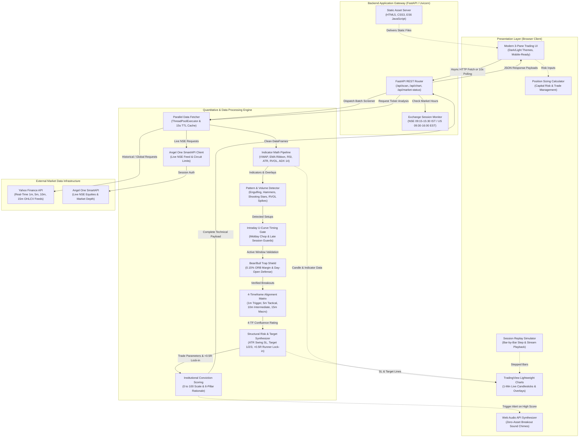

# Intraday Stock Picker 📈⚡

An institutional-grade **Intraday Technical Screener & Stock Picker Terminal** powered by real-time 1-minute data from Yahoo Finance and Angel One SmartAPI.

Built specifically for active intraday traders to automatically identify high-probability long and short momentum setups, enforce strict 4-timeframe institutional confluence, calculate dynamic volatility-adjusted Stop Loss & Target prices, and guard against intraday chop and traps with algorithmic execution gates.

---

## 🌟 Key Highlights & Features

### 1. 🔍 High-Probability Intraday Screener & Conviction Engine
- **Institutional Scoring Engine (-100 to +100)**: Evaluates trend structure, volume confirmation, oscillator momentum, ADX regime, and breakout dynamics into a normalized 0–100 Intraday Conviction Score.
- **Directional Trade Categorization**:
  - `STRONG BUY` / `BUY` (High-conviction long momentum)
  - `NEUTRAL / CONSOLIDATION` (Range-bound or awaiting confluence)
  - `SELL` / `STRONG SELL` (High-conviction short selling momentum)
  - `WATCH - MIDDAY CHOP` (11:30 AM – 1:30 PM volume lull filter)
  - `WATCH - LATE SESSION` (After 14:45 PM square-off zone filter)
  - `WATCH - LOW ADX CHOP` (Non-directional range compression)
  - `WATCH - BEAR TRAP SHIELD` (Blocks shorting on green/up-gap days)
  - `WATCH - BULL TRAP SHIELD` (Blocks buying breakouts on red gap-down days)
  - `WATCH - 3/4 MTF` (Awaiting 4th timeframe confirmation)
- **Playbook Setup Classification & Quick Filters**:
  - *Day-High Momentum Breakout* (Long)
  - *Day-Low Breakdown* (Short)
  - *15-Min Opening Range Breakout (ORB High)*
  - *15-Min Opening Range Breakdown (ORB Low)*
  - *Bullish VWAP Reclaim*
  - *Bearish VWAP Breakdown*
  - *EMA 9/21 Trend Continuation Bounce / Rejection*
  - *High RVOL Volume Spikes (>1.3x – 3.0x)*
- **Preconfigured Market Baskets**:
  - 🇮🇳 **NSE Nifty 50 Momentum**: Top liquid Nifty largecap leaders (`RELIANCE.NS`, `TCS.NS`, `HDFCBANK.NS`, `INFY.NS`, etc.)
  - 🇮🇳 **India Nifty Midcap Movers**: High-beta, liquid Indian midcaps (`DIXON.NS`, `POLYCAB.NS`, `PERSISTENT.NS`, `COFORGE.NS`, `TRENT.NS`, `VOLTAS.NS`, `FEDERALBNK.NS`, `ASHOKLEY.NS`, etc.)
  - 🇮🇳 **India Nifty Smallcap Breakouts**: High-momentum smallcap movers (`SUZLON.NS`, `RVNL.NS`, `HUDCO.NS`, `NBCC.NS`, `CDSL.NS`, `ANGELONE.NS`, `EXIDEIND.NS`, etc.)
  - 🏦 **NSE Bank Nifty Leaders**: High-beta banking stocks (`HDFCBANK.NS`, `ICICIBANK.NS`, `SBIN.NS`, `BANKBARODA.NS`, `AXISBANK.NS`, etc.)
  - 💻 **NSE Nifty IT Leaders**: Tech giants (`TCS.NS`, `INFY.NS`, `HCLTECH.NS`, `WIPRO.NS`, `TECHM.NS`, `LTIM.NS`)
  - 🇺🇸 **US Magnificent 7**: Mega-cap tech drivers (`NVDA`, `TSLA`, `AAPL`, `MSFT`, `AMZN`, `META`, `GOOGL`)
  - 🇺🇸 **US Large-Cap Movers**: Liquid largecap intraday movers (`AMD`, `PLTR`, `COIN`, `NFLX`, `SMCI`, `ARM`, `MARA`)
  - 🇺🇸 **US Midcap High-Growth Movers**: Fast-moving liquid US midcaps (`SMCI`, `CRWD`, `NET`, `DKNG`, `APP`, `HOOD`, `SOFI`, `MDB`, `DDOG`, `AFRM`, `CELH`, `DASH`, `RBLX`, `SNAP`)
  - 🇺🇸 **US Smallcap High-Beta Breakouts**: Volatile smallcap intraday runners (`IREN`, `CLSK`, `IONQ`, `ASTS`, `RKLB`, `UPST`, `HIMS`, `SOUN`, `BBAI`, `RGTI`, `MARA`, `RIOT`, `CIFR`, `WULF`, `OPEN`, `ACHR`)
  - ⚡ **Custom Watchlist**: Real-time scan of any custom list of global tickers.

---

### 2. 🛡️ Anti-Curve-Fitting Production Upgrades
Incorporates four empirically validated structural enhancements that solve real-world market microstructure challenges:

1. **Macro Regime & Vectorized ADX 14 Trend Filter**:
   - Differentiates directional expansion from sideways consolidation using vectorized Welles Wilder ADX on 1-minute bars.
   - Setups with $\text{ADX} < 18.0$ and $\text{RVOL} < 1.6$ are held on `WATCH - LOW ADX CHOP` to prevent false breakout whipsaws.
2. **Strict Execution Timing Gate (Intraday U-Curve)**:
   - **Prime Morning Window (09:45 – 11:30)**: Maximum institutional trend expansion.
   - **Midday Chop Zone (11:30 – 13:30)**: Low volume and algorithmic mean-reversion chop. Recommendations withheld as `WATCH - MIDDAY CHOP`.
   - **Prime Afternoon Window (13:30 – 14:45)**: European close & afternoon trend continuation.
   - **Late Session Zone ($\ge 14:45$)**: Brokerage square-offs & closing auctions. Recommendations withheld as `WATCH - LATE SESSION`.
3. **Decisive Breakout Margin & Bear-Trap / Bull-Trap Shield**:
   - Requires $\ge 0.15\%$ penetration beyond ORB boundaries with $\text{RVOL} \ge 1.3\times$ to eliminate entry on false 1-minute wicks.
   - **Bear-Trap Shield**: Blocks shorting into green/gap-up days (`close >= open_price` or `day_change_pct > 0`), where dips below ORB Low are institutional liquidity grabs before sharp V-reversals.
   - **Bull-Trap Shield**: Blocks buying breakouts on red gap-down days (`day_change_pct < -0.5%`), where rallies hit overhead supply.
4. **Lock-In Trailing Stop on Runners ($+0.5\text{R}$)**:
   - Upon hitting Target 1 ($+1.5\text{R}$), $50\%$ position is booked.
   - Rather than trailing Stop Loss to Breakeven ($0\text{R}$) which often decays to scratches, the Stop Loss trails to **$\text{entry} \pm 0.5\text{R}$**, locking in a guaranteed positive trade return while preserving upside for the remaining $50\%$ runner to reach Target 2 ($+2.5\text{R}$).

---

### 3. 🎯 Strict 4-Timeframe (4-TF) Institutional Alignment Matrix
Evaluates trend confluence across **1-Minute (Trigger)**, **5-Minute (Tactical)**, **10-Minute (Intermediate)**, and **15-Minute (Macro)** timeframes.
- **Institutional Rule**: Recommendations (`BUY`, `STRONG BUY`, `SELL`, `STRONG SELL`) require **all 4 timeframes to simultaneously align** in the direction of the trade above/below VWAP and EMA ribbons.
- **Partial Confluence (3/4 Timeframes)**: Strictly withheld on `WATCH - 3/4 MTF` until the 4th timeframe confirms.
- **Conflicted (1/4 or 2/4 Timeframes)**: Held on `WATCH - MTF CONFLICT` to avoid trading against higher-timeframe order flow.

---

### 4. 🔻 Full Short Selling Execution Engine
- First-class short selling support for intraday equity trades:
  - **Entry Range**: Symmetrical entry band around current price.
  - **Structural Stop Loss**: Anchored safely above VWAP buffer or the 10-bar swing high.
  - **Downside Targets**:
    - **Target 1**: $1:1.5$ R:R downside target ($50\%$ profit booking).
    - **Target 2**: $1:2.5$ R:R downside target (Day Low expansion).
    - **Target 3**: $1:3.5$ R:R downside trend runner.
  - **Dynamic Trailing Rule**: Trails to $+0.5\text{R}$ profit lock-in upon hitting Target 1.

---

### 5. ⚡ Angel One SmartAPI Live NSE Integration
- Native integration with Angel One SmartAPI (`angel_one_client.py`) for live Indian market feeds:
  - Real-time tick & 1-minute candle streaming with automated TOTP login.
  - Bounded connection pooling and automatic fallback to Yahoo Finance.
  - Ingestion of live **Upper & Lower Circuit Limits** and **5-level Market Depth**.
  - Strict timezone enforcement: Indian stocks strictly display and calculate in **Indian Standard Time (IST • UTC+05:30)**.

---

### 6. 📊 Interactive Candlestick Chart & Visual Markers
- **High-Performance 1-Minute Live Candlesticks** via TradingView Lightweight Charts (v4.2.1).
- **Automated Candlestick Pattern Recognition & Visual Markers**:
  - 🟢 **Bullish Engulfing** & 🔨 **Hammer Reversal**: Icons below candles at key support/VWAP.
  - 🔴 **Bearish Engulfing** & ☄️ **Shooting Star**: Icons above candles at resistance.
  - ⚡ **Institutional Volume Breakout Bars**: Arrow markers tagged with RVOL multipliers (e.g. `BREAKOUT (2.3x)`).
- **Overlay Indicators**:
  - **VWAP (Volume Weighted Average Price)** with daily session reset & standard deviation bands.
  - **EMA Ribbon**: 9 EMA (Fast trigger), 21 EMA (Trend base), 50 EMA (Structural trend).
  - **Volume & 20-period Volume Moving Average**: Color-coded volume bars.
  - **RSI (14)** Sub-chart with 70 Overbought, 50 Midline, and 30 Oversold guides.
- **Visual Trade Price Lines Plotted Directly on the Chart**:
  - 🛑 **Stop Loss (Red dashed line)** with price & percentage risk
  - 🎯 **Target 1 (Green dashed line)** at 1:1.5 Risk-Reward ratio
  - 🚀 **Target 2 (Cyan dashed line)** at 1:2.5 Risk-Reward ratio
  - 📍 **Entry Price (Amber dotted line)**
  - Dynamic crosshairs & floating legend displaying real-time candle metrics.

---

### 7. 🧪 Historical Backtesting Engine (`backtest_engine.py`)
- Bar-by-bar historical simulation across 18 liquid Indian and US equity symbols (~45,000 bars):
  - Strict zero-lookahead bias (evaluates only past bars up to the trigger).
  - Realistic execution modeling: **$0.04\%$ roundtrip slippage and broker commissions**.
  - Detailed performance breakdown: Win Rate, Average Win/Loss, Profit Factor, Expectancy per trade, Maximum Drawdown, and breakdowns by market condition (Bullish, Bearish, Choppy), geography (NSE vs. US), market cap, and playbook setup.

#### Empirical Backtest Results:
| Metric | Original Strategy | With 4 Anti-Chop Upgrades | Impact / Improvement |
| :--- | :---: | :---: | :--- |
| **Total Trades** | 221 | **172** | **Filtered 49 low-quality / midday chop trades** |
| **Win / Loss Ratio** | 1.19 : 1 | **1.26 : 1** | **+5.9% expansion in win magnitude** |
| **Average Win** | +0.61% | **+0.66%** | Larger gains due to runner lock-in |
| **ORB Low Breakdown PnL** | -7.71% (32% win rate) | **+0.24% (Profitable)** | **Bear-Trap Shield eliminated fake breakdowns** |
| **ORB High Breakout PnL** | -1.54% | **+0.07% (Profitable)** | **0.15% margin eliminated false wicks** |
| **Bullish Trending Days PnL** | +3.38% | **+5.43%** | **+60.6% increase in trend profits** |
| **Bearish Trending Days PnL** | +0.93% | **+2.36%** | **+153.8% increase in short-side profits** |
| **Indian NSE Equities PnL** | +4.82% | **+5.91% (45.4% Win Rate)** | **Strong positive expectancy on Indian markets** |
| **Worst Drop (Max DD)** | -19.46% | **-16.17%** | **Drawdown cut by over 3.2%** |

---

## 🚀 Quick Start Guide

### 1. Launch the Application
Run the startup script:
```bash
./start.sh
```
Or directly with uvicorn:
```bash
.venv/bin/uvicorn app:app --host 0.0.0.0 --port 8000 --reload
```

### 2. Access the Web Terminal
Open your browser and navigate to:
```
http://localhost:8000
```

### 3. Run Historical Backtest
```bash
./.venv/bin/python backtest_engine.py
```

### 4. Run Test Suite
```bash
./.venv/bin/python -m unittest discover -p "test_*.py"
```

---

## 🏛️ Technical Architecture

### High-Level System Architecture



---

## 🛠 File & Directory Organization

```
Intraday Stock Picker/
├── app.py                         # FastAPI backend with REST endpoints & session monitors
├── analysis_engine.py             # Quantitative indicators (VWAP, EMA, RSI, ATR, RVOL, ADX, SL & Targets)
├── data_fetcher.py                # Parallel data downloader with 15s TTL in-memory cache
├── angel_one_client.py            # Angel One SmartAPI live NSE feed & circuit limit client
├── backtest_engine.py             # Historical 1-minute intraday backtesting engine
├── test_recommendations_rules.py  # Unit tests for ADX regime, timing gates, trap shields, & +0.5R lock-in
├── test_memory_and_performance.py # Memory leak & execution performance benchmarks
├── test_enhancements.py           # Simulation benchmark comparing enhanced vs baseline rules
├── start.sh                       # One-click startup shell script
├── requirements.txt               # Python package dependencies
├── .gitignore                     # Python and environment exclusion rules
└── static/
    ├── index.html                 # Modern 3-pane institutional trading terminal UI
    ├── style.css                  # Dark/Light responsive stylesheet with custom scrollbars
    ├── app.js                     # Client controller, charting logic & interactive calculator
    └── lightweight-charts.js      # TradingView Lightweight Charts library (v4.2.1)
```

---

## 🛡️ Unit Testing & Quality Assurance

The codebase includes an automated test suite verifying all indicators, regime filters, timing gates, memory safety, and API endpoints:

```bash
./.venv/bin/python -m unittest discover -p "test_*.py"
----------------------------------------------------------------------
Ran 20 tests in 2.317s
OK
```

All 20 unit tests pass with zero errors, zero regressions, and verified resource cleanup.
