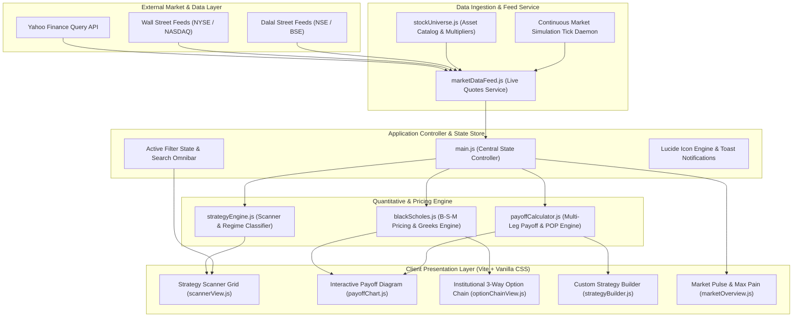

# Option Trading Picker 🎯

> **Institutional Quantitative Derivatives & Strategy Scanner for USA and Indian Stock Markets**  
> Real-Time Options Greeks, Dynamic 3-Way Option Chain, Payoff Diagram Visualizer, and Multi-Leg Strategy Builder.

---

## 📌 Executive Summary

**Option Trading Picker** is a professional-grade quantitative derivatives analytics and strategy scanning platform engineered for equities and benchmark indices across **Wall Street (USA)** and **Dalal Street (India)**. 

The application utilizes the **Black-Scholes-Merton** mathematical pricing model to continuously evaluate volatility skews, analyze Greeks ($\Delta, \Gamma, \Theta, \nu$), estimate Probability of Profit (POP %), calculate Max Pain pinning targets, and scan for optimal Call and Put option trade setups under varying market regimes.

---

## 🌟 Key Functional Pillars

### 1. Dual-Market & Dual-Asset Coverage
* **USA Benchmark Indices (Large, Mid & Small)**: `SPX` (S&P 500), `QQQ` (Nasdaq 100), `DIA` (Dow Jones), `MDY` (S&P MidCap 400 ETF), `IWM` (Russell 2000 Small-Cap ETF), `IJR` (S&P Small-Cap 600 ETF), `VIX` (Volatility Index).
* **USA Large-Cap Equities**: `NVDA`, `AAPL`, `TSLA`, `MSFT`, `AMZN`, `META`, `GOOGL`, `AMD`.
* **USA Midcap Equities**: `COIN`, `PLTR`, `SMCI`, `CRWD`, `NET`, `DKNG`, `APP`, `HOOD`, `SOFI`.
* **USA Smallcap Equities**: `IREN`, `CLSK`, `IONQ`, `ASTS`, `RKLB`, `UPST`, `HIMS`.
* **India Benchmark Indices (Large, Mid & Small)**: `NIFTY 50`, `BANKNIFTY`, `FINNIFTY`, `MIDCPNIFTY` (NSE Nifty Midcap Select F&O), `NIFTY_SMALLCAP` (NIFTY Smallcap 100), `SENSEX`.
* **India Large-Cap Equities (Nifty 50)**: `RELIANCE`, `HDFCBANK`, `TATAMOTORS`, `ICICIBANK`, `INFY`, `TCS`, `SBIN`, `BHARTIARTL`, `LT`, `ITC`, `BAJFINANCE`, `TATAPOWER`.
* **India Midcap Equities**: `DIXON`, `POLYCAB`, `PERSISTENT`, `COFORGE`, `TRENT`, `VOLTAS`, `FEDERALBNK`, `ASHOKLEY`.
* **India Smallcap Equities**: `SUZLON`, `RVNL`, `HUDCO`, `NBCC`, `CDSL`, `BSE`, `ANGELONE`, `EXIDEIND`.

### 2. Multi-Regime Strategy Scanner (Tabular Format Default & Card Format)
Automatically classifies market regimes (directional momentum, high/low IV, support/resistance, range-bound consolidation) and suggests optimal multi-leg option structures with flexible presentation modes:
* **📋 Tabular Format (Default)**: High-density institutional table detailing Asset & Price, Strategy / Bias, Recommended Expiry & DTE, Legs Structure, POP Win Rate, Max Profit, Max Loss, R:R, Breakevens, IV Rank & Net Theta, Simple Exit Plan (Target & Stop spot levels with cash ROI per lot), and 1-click Action buttons (`Analyze`, `Chain`, `Build`, and Expandable Detail Drawer for institutional catalysts).
* **🗂️ Card Grid Format**: Responsive visual card grid featuring financial metric blocks, visual directional badges, and simplified layman risk management guides.
* **⚡ One-Click View Switcher**: Prominently situated view mode toggle (`Table` ⇄ `Cards`) with persistent local storage saving user preference.
* **⚡ Theta Decay & Time Value Harvest**: Theta Decay Harvester (ATM Iron Butterfly Pin — pure positive Net Theta $\Theta > 0$ collection engine), Calendar Time Spreads.
* **Bullish Momentum**: Long Call (Breakout), Bull Call Spread (Debit), Bull Put Spread (Credit), Cash-Secured Put.
* **Bearish Momentum**: Long Put (Breakdown), Bear Put Spread (Debit), Bear Call Spread (Credit).
* **Delta-Neutral & Income**: Iron Condor (Consolidation harvest), Iron Butterfly (Pinning strike), Covered Call (Buy-Write).
* **Volatility Breakouts**: Long Straddle & Long Strangle (Compression squeeze).

### 3. Disciplined Exit Plan: Stop Loss & Target Price Booking
Designed specifically for disciplined risk managers and less risk-averse traders who prefer controlled, systematic exits rather than holding options into binary expiration or total loss:
* **🎯 Target Price Booking**: Computes underlying spot target, required percentage move, target option exit price, and currency gain per lot (+50% to +70% target ROI for debit trades; 50% max profit capture for credit spreads and Iron Condors).
* **🛑 Stop Loss Protection**: Explicit invalidation trigger on underlying spot, option stop-loss cut rule (e.g., cut at -40% to -45% debit loss or 1.5x credit collected), and exact currency risk per lot.
* **⚖️ Realized Managed Risk/Reward**: Recalculates risk/reward based on the active exit plan (e.g., `1 : 2.1`) rather than unrealistic theoretical expiration assumptions.
* **🛡️ Capital Preservation**: Quantifies the percentage of capital preserved (typically 55% to 70%) versus holding unmanaged positions to 100% loss at expiration.
* **Filter by Risk Profile**: Scanner toolbar allows instant filtering by `All Risk Disciplines`, `Low Risk (Conservative Stops & 50% Profit Booking)`, and `Balanced Risk (Disciplined Stop & 55% ROI Target)`.
* **Visual Chart Thresholds**: Payoff Diagram plots dashed horizontal threshold lines for Target Exit and Stop Loss triggers directly across the P&L curve.

### 4. Interactive Strategy Payoff Curve
* **Dual-Curve Payoff Visualizer**: Powered by `Chart.js`, dynamically plots **Expiration P&L** (solid curve with shaded emerald/rose profit & loss zones) alongside **T+0 P&L Today** (neon dashed curve using live Black-Scholes pricing).
* **Target & Stop Loss Threshold Lines**: Displays emerald dashed line for Target Profit Exit and rose dashed line for Stop Loss Trigger.
* **Risk & Probability Metrics**: Immediate calculation of Breakeven points, Max Profit, Max Loss, Managed Risk/Reward ratio, and Probability of Profit (POP %).

### 5. Institutional 3-Way Option Chain with Alpha, Beta, Gamma, Theta
* Classic institutional trading desk format: **Calls | Strike Price Ladder | Puts**.
* **Full Greeks & Risk Suite Per Strike**:
  * **Alpha ($\alpha$)**: Theoretical mispricing edge & expected excess yield (%) comparing Implied Volatility against Historical Volatility and underlying momentum alpha.
  * **Beta ($\beta$)**: Option systematic market sensitivity multiplier ($\beta_{\text{opt}} = \Omega \times \beta_{\text{asset}}$), showing leveraged upside exposure for Calls ($>0$) and inverse portfolio hedge exposure for Puts ($<0$).
  * **Gamma ($\Gamma$)**: High-precision second-order Greek measuring the acceleration of Delta per $1 unit move in underlying spot.
  * **Theta ($\Theta$)**: Daily time decay expressed in currency erosion per share per day.
  * **Delta ($\Delta$)** and **Implied Volatility (IV %)**.
* **Segmented View Mode Switcher**:
  * `📊 All Columns`: Complete 23-column institutional trading desk view with high-density data.
  * `🔬 Greeks Suite (α, β, γ, θ, Δ)`: Focused quantitative view highlighting analytical Greeks alongside LTP.
  * `📈 Depth & Liquidity`: Execution-focused view with OI Heatmap, Volume, Bid, Ask, and Delta.
* **Top KPI Greek Highlights**: Real-time cards displaying **ATM Gamma ($\Gamma$)**, **ATM Theta ($\Theta$)**, **Asset Beta ($\beta$)**, and **Option Alpha ($\alpha$)** edge alongside Spot, IV, PCR, and Max Pain.
* **One-Click Leg Insertion**: Direct click on any Bid or Ask price instantly imports that leg into the Strategy Builder.

### 6. Custom Multi-Leg Strategy Builder & Simulator
* Construct custom 1 to 4 legged option structures with customized Actions (`BUY` / `SELL`), Types (`CALL` / `PUT`), Strikes, Expirations, Contracts, and Premiums.
* Aggregates Net Debit/Credit, Total Margin, Net Portfolio Greeks, and plots directly to the interactive Payoff Visualizer.

### 7. Market Pulse & Max Pain Radar
* Real-time trading session status monitoring for **Wall Street (NYSE/NASDAQ)** and **Dalal Street (NSE/BSE)**.
* Benchmark index cards with Put-Call Ratio (PCR), IV Rank, and Max Pain strikes.
* **Elevated IV Rank Leaderboard** (Top candidates for Premium Sellers).
* **Low IV Rank Leaderboard** (Top candidates for Option Buyers).

---

## 🏛️ High-Level Technical Architecture

The following diagram illustrates the high-level tier breakdown of the **Option Trading Picker** platform, spanning from external market data providers down to the client presentation interface:



---

## 🔍 Low-Level Technical Architecture & Calculation Pipeline

The low-level technical diagram outlines the internal data pipeline, component dependencies, and mathematical processing cycles:

```mermaid
sequenceDiagram
    autonumber
    actor Trader as "Options Trader"
    participant UI as "App Header & Tabs UI"
    participant Controller as "main.js (Controller)"
    participant Feed as "marketDataFeed.js"
    participant BS as "blackScholes.js (Quant Engine)"
    participant Engine as "strategyEngine.js"
    participant Payoff as "payoffCalculator.js"
    participant ChartUI as "payoffChart.js (Chart.js)"
    participant ChainUI as "optionChainView.js"

    Trader->>UI: Selects Asset / Enters Search Query (e.g. NVDA or NIFTY 50)
    UI->>Controller: Dispatches asset selection / filter event
    Controller->>Feed: fetchLiveQuote(asset)
    Feed-->>Controller: Returns Spot Price, Day Change, IV, PCR, Max Pain
    
    rect rgb(20, 28, 45)
        note over Controller, Engine: Quantitative Strategy Scanning Cycle
        Controller->>Engine: scanStrategiesForAsset(quote)
        loop Across Expirations & Regimes
            Engine->>BS: calculateGreeks(type, S, K, T, r, sigma)
            BS-->>Engine: Delta, Gamma, Theta, Vega, Intrinsic, Extrinsic
            Engine->>BS: calculatePOP(S, breakeven, T, sigma, isBullish)
            BS-->>Engine: Probability of Profit (POP %)
            Engine->>Payoff: calculatePayoffProfile(legs, S, lotSize, dte, sigma, r)
            Payoff-->>Engine: Expiry P&L, T+0 Curve, Breakevens, Max Profit/Loss
        end
        Engine-->>Controller: Ranked Strategy Cards (Bullish, Bearish, Neutral, Vol)
    end

    Controller->>UI: Renders Strategy Scanner Grid (scannerView.js)

    opt Trader clicks "Analyze Payoff Curve"
        Trader->>UI: Click "Analyze Payoff Curve"
        UI->>Controller: switchTab("tab-analyzer")
        Controller->>Payoff: calculatePayoffProfile(strat.legs, S, lotSize, dte, sigma, r)
        Payoff-->>ChartUI: pricePoints, expiryPnL, currentPnL, breakevens
        ChartUI->>UI: Renders interactive Chart.js canvas with profit/loss zones
    end

    opt Trader clicks "Option Chain"
        Trader->>UI: Click "Live Option Chain"
        UI->>Controller: switchTab("tab-chain")
        Controller->>Feed: generateOptionChain(quote, selectedDte)
        Feed->>BS: Computes skew-adjusted Greeks across 25 strikes
        Feed-->>ChainUI: Formatted Call & Put matrices with OI heatmaps
        ChainUI->>UI: Renders 3-way Option Chain table
    end
```



---

## 🧮 Mathematical Engine & Formulas

### 1. Black-Scholes-Merton Pricing Formula
For European and American style options:

$$d_1 = \frac{\ln(S / K) + \left(r + \frac{\sigma^2}{2}\right)T}{\sigma \sqrt{T}}$$

$$d_2 = d_1 - \sigma \sqrt{T}$$

* **Call Price ($C$)**:
  $$C = S \cdot N(d_1) - K e^{-rT} N(d_2)$$
* **Put Price ($P$)**:
  $$P = K e^{-rT} N(-d_2) - S N(-d_1)$$

Where:
* $S$ = Current Underlying Spot Price
* $K$ = Strike Price
* $T$ = Time to Expiration in Years ($\text{DTE} / 365$)
* $r$ = Risk-free Interest Rate ($4.5\%$ for US, $6.5\%$ for India)
* $\sigma$ = Implied Volatility (annualized)
* $N(x)$ = Standard Normal Cumulative Distribution Function (evaluated via Hart / Abramowitz-Stegun polynomial approximation with precision $< 10^{-7}$).

### 2. Option Greeks Suite
* **Delta ($\Delta$)**: Rate of change of option price with respect to underlying spot price:
  $$\Delta_{\text{Call}} = N(d_1), \quad \Delta_{\text{Put}} = N(d_1) - 1$$
* **Gamma ($\Gamma$)**: Second derivative of option price with respect to underlying price:
  $$\Gamma = \frac{N'(d_1)}{S \sigma \sqrt{T}}$$
* **Theta ($\Theta$)**: Daily decay in currency:
  $$\Theta_{\text{Call}} = \frac{1}{365} \left( -\frac{S N'(d_1) \sigma}{2\sqrt{T}} - r K e^{-rT} N(d_2) \right)$$
  $$\Theta_{\text{Put}} = \frac{1}{365} \left( -\frac{S N'(d_1) \sigma}{2\sqrt{T}} + r K e^{-rT} N(-d_2) \right)$$
* **Vega ($\nu$)**: Sensitivity per $1\%$ change in volatility:
  $$\nu = \frac{S \sqrt{T} N'(d_1)}{100}$$
* **Option Beta ($\beta_{\text{opt}}$)**: Systematic market sensitivity and gearing multiplier:
  $$\beta_{\text{opt}} = \Omega \times \beta_{\text{asset}} = \left(\frac{S \cdot \Delta}{V}\right) \times \beta_{\text{asset}}$$
* **Option Alpha ($\alpha_{\text{opt}}$)**: Theoretical mispricing edge & expected excess yield (%):
  $$\alpha_{\text{opt}} = 0.4 \left(\frac{\text{HV} - \text{IV}}{\text{IV}} \times 100\right) + \Omega \cdot \frac{\alpha_{\text{asset}}}{100} \cdot T \cdot 100$$

### 3. Probability of Profit (POP %)
Computed using the log-normal distribution of underlying price reaching breakeven at expiration:

$$Z = \frac{\ln(\text{Breakeven} / S) - \left(r - \frac{\sigma^2}{2}\right)T}{\sigma \sqrt{T}}$$

$$\text{POP}_{\text{Bullish}} = \left[1 - N(Z)\right] \times 100\%, \quad \text{POP}_{\text{Bearish}} = N(Z) \times 100\%$$

---

## 📁 Project Directory Structure

```
Option Trading Picker/
├── index.html                  # Main HTML Shell, navigation tabs, and modular panels
├── vite.config.js              # Vite server configuration (runs on port 5174)
├── package.json                # Project dependencies (chart.js, lucide)
├── README.md                   # Technical documentation & architecture diagrams
└── src/
    ├── style.css               # Comprehensive financial terminal design system & theme variables
    ├── main.js                 # Central state manager, event listeners, and live ticker daemon
    ├── quant/
    │   ├── blackScholes.js     # High-precision Black-Scholes analytical pricing & Greeks
    │   ├── strategyEngine.js   # Multi-regime strategy scanner & classifier
    │   └── payoffCalculator.js # Payoff profile, zero crossings, risk/reward, and T+0 curves
    ├── data/
    │   ├── stockUniverse.js    # Curated universe of US & Indian stocks/indices & lot sizes
    │   └── marketDataFeed.js   # Live quotes ingestor, dynamic option chain, and tick simulator
    └── components/
        ├── scannerView.js      # Strategy Scanner cards renderer & multi-criteria filter
        ├── payoffChart.js      # Chart.js interactive payoff diagram visualizer
        ├── optionChainView.js  # Institutional 3-way Option Chain table with OI heatmap
        ├── strategyBuilder.js  # Interactive custom combo builder & preset templates
        ├── marketOverview.js   # Macro session status, index cards, & IV Rank leaderboards
        └── toast.js            # Smooth animated notification utility
```

---

## 🚀 Getting Started

### Prerequisites
* **Node.js** (v18.0.0 or higher)
* **npm** (v9.0.0 or higher)

### Installation
```bash
# Navigate to the project directory
cd "Option Trading Picker"

# Install dependencies (Vite, Chart.js, Lucide Icons)
npm install
```

### Running Locally (Development Mode)
```bash
npm run dev
```
Open **[http://localhost:5174/](http://localhost:5174/)** in your browser.

### Production Build
```bash
npm run build
```
Creates an optimized production bundle inside the `dist/` directory.

---

## 🔒 Security & Data Integrity
* **Client-Side Analytical Processing**: All Greek calculations, payoff simulations, and Black-Scholes computations run entirely in the browser using high-precision JavaScript arithmetic.
* **Resilient Market Simulation**: In the event of network disruption or CORS restrictions on external quote endpoints, the embedded simulation tick generator guarantees continuous, non-breaking platform availability.
