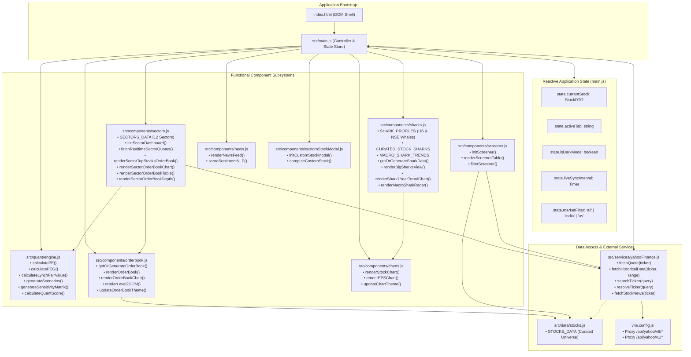
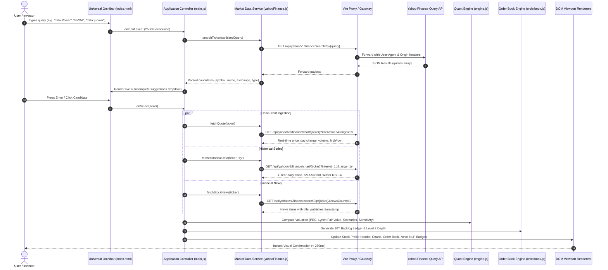
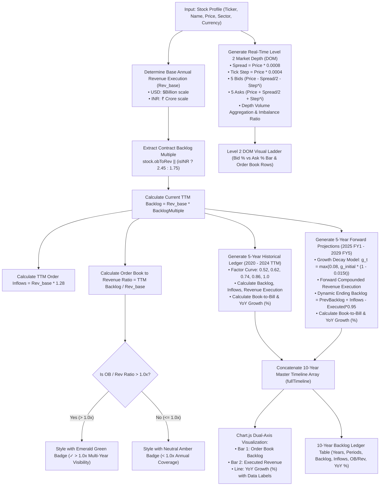
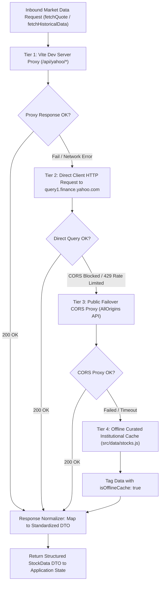

# Quantitative Stock Analysis — Institutional Stock Market Analysis & Valuation Engine

[](https://opensource.org/licenses/MIT)
[](https://vitejs.dev/)
[](https://developer.mozilla.org/en-US/docs/Web/JavaScript)
[](#supported-exchanges)
[](#market-data-architecture)

Quantitative Stock Analysis is an institutional-grade, responsive quantitative equity analysis web platform designed for quants, portfolio managers, and individual investors. It provides real-time market data streaming from **NSE India (National Stock Exchange)** and **US Markets (NASDAQ / NYSE)**, Peter Lynch **Growth-At-A-Reasonable-Price (GARP)** valuation models, future earnings projections, 2D sensitivity stress matrices, technical momentum indicators, financial NLP sentiment analysis, and a real-time GARP radar screener.

---

## 🌟 Key Features

### 1. 🔍 Universal Omnibar Search & Fuzzy Resolution
- **Search Any Stock**: Search any company listed on **NSE India (`.NS` / `.BO`)** or **US Exchanges (NASDAQ / NYSE)** by company name, ticker symbol, or keywords (e.g., `Tata Power`, `Reliance`, `Apple`, `Nvidia`, `TATAPOWER`, `SBIN`, `PLTR`).
- **Typo & Symbol Sanitization**: Automatically handles keyboard typos and accidental punctuation (e.g. `Tata p[ower` cleans directly to `TATAPOWER.NS`).
- **Instant Autocomplete & Direct Enter Resolution**: Hitting <kbd>Enter</kbd> or clicking the search icon instantly resolves company names to valid exchange tickers and loads live streaming quotes.

### 2. 📈 Peter Lynch GARP & Valuation Models
- **PEG Ratio Analysis**: Real-time PEG calculation ($\text{Forward P/E} \div \text{Annual EPS Growth Rate}$). Highlights undervalued stocks with $\text{PEG} < 1.0$ (Peter Lynch margin-of-safety benchmark).
- **Peter Lynch Fair Value**: Dynamically calculated using forward EPS and projected growth rate.
- **Projected Compounded Annual Return (CAGR)**: Models total return over 1 to 5 years based on earnings compounding and multiple expansion/contraction.

### 3. 🎯 3-Scenario Stress Test & 2D Sensitivity Matrix
- **Scenario Analysis**:
  - **Bear Case**: -30% EPS growth haircut + 20% P/E multiple contraction.
  - **Base Case**: Consensus EPS trajectory with market exit P/E.
  - **Bull Case**: +25% growth acceleration + 15% multiple expansion.
- **2D Sensitivity Matrix**: Interactive heatmapped matrix modeling target stock returns across terminal P/E multiples (15x to 45x) versus annual growth rates (10% to 40%).

### 4. 📊 Technical Momentum & Candlestick Charts
- **1-Year Daily Price Series**: Chart.js powered interactive daily chart with volume bars.
- **Moving Averages**: Live 50-day and 200-day Simple Moving Averages (SMAs) with Golden Cross / Death Cross indicator tags.
- **14-Day RSI (Relative Strength Index)**: Wilder's smoothed momentum oscillator indicating Overbought (>70) and Oversold (<30) regimes.
- **Dynamic Support & Resistance**: Rolling 30-day pivot bounds.

### 5. 📰 Financial News Feed & NLP Sentiment Scoring
- **Real-Time News Stream**: Curated breaking financial news headlines fetched via Yahoo Finance API.
- **Chronological Sorting**: News entries sorted descending by publish timestamp.
- **Quantitative NLP Sentiment Scoring**: Financial lexicon NLP classifier scoring headlines as Bullish, Neutral, or Bearish (-1.0 to +1.0).

### 6. 📡 Real-Time GARP Radar Screener
- Live screener table tracking all universe stocks.
- Filter by exchange: **All**, **NSE India 🇮🇳**, or **US Equities 🇺🇸**.
- Quick toggle for $\text{PEG} < 1.0$ GARP opportunities.
- Real-time sortable by Date, PEG, Expected CAGR, and Fair Value Upside.

### 7. 🎛️ Custom Valuation Sandbox (+ Custom Model)
- Modal dialog allowing quants to model any custom ticker or private company by adjusting EPS growth rates, target P/E ratios, and holding horizons.

### 8. 🌓 Institutional Dark / Light Mode & Ticker Tape
- High-contrast institutional dark theme with glassmorphism cards and vibrant data visualizations.
- Streaming top market indices ticker tape: **NIFTY 50**, **SENSEX**, **S&P 500**, and **NASDAQ Composite**.

### 9. 📚 Real-Time Order Book & 10-Year Order History (Last 5 Years & Next 5 Years)
- **10-Year Order History Dual-Axis Chart**: Grouped bar visualization comparing **Order Book Backlog**, **New Order Inflows**, and **Executed Revenue** alongside a dedicated secondary right-axis **YoY Growth (%)** line with on-chart floating percentage badges across 2020–2024 (Historical) and 2025–2029 (Forward Projections).
- **YoY Growth Display in %**: Displayed on the 10-year chart with interactive data points, floating percentage labels (`+XX.X%`), interactive tooltips, and in the **10-Year Order Book Ledger Table** as styled quantitative pill badges.
- **Order Book to Revenue Ratio**: Dedicated KPI metric and ledger column measuring contracted backlog coverage relative to annual revenue. **Automatically marked in green when $> 1.0\times$** (indicating contracted multi-year revenue visibility).
- **KPI Metrics**: Total Current Backlog, Order Book to Revenue Ratio ($Backlog \div Revenue$), Book-to-Bill Ratio ($Inflows \div Revenue$), Revenue Visibility (Years of execution locked in), and 5-Year Forward Backlog CAGR.
- **10-Year Order Book Ledger Table**: Full multi-column data table including Year, Period, Order Book, Inflows, Executed Revenue, OB / Rev Ratio (green pills when $> 1.0\times$), Book-to-Bill, and YoY Growth (%).
- **Real-Time Level 2 Market Depth (DOM)**: Live depth ladder displaying top bids, top asks, bid-ask spread, and order flow imbalance ratio.
- **Commercial Contract Segments**: Revenue backlog breakdown across key business units and high-growth verticals.

### 10. 🌐 All Sectors Dashboard (Ranked by YTD Return Descending)
- **Top Navigation Bar Menu Item**: Positioned prominently in the top application header right where `+ Custom Model` is located, giving instant one-click access to broad market sector rotation and performance.
- **Dedicated Sector Full-View Mode**: Automatically hides the Stock Card (`#stockHeroCard`), Quick Watch Chips, and stock-specific Nav Tabs (`.nav-tabs`) when the Sector Dashboard is selected, dedicating 100% of the viewport to macro sector rotation, quant leaders, and order backlog analytics. Includes an interactive "← Back to Stock Terminal" button and top nav toggle to smoothly return to stock analysis.
- **Sorted by YTD Descending**: All 12 primary market sectors strictly ranked from top alpha generator (Semiconductors & AI Hardware $+64.8\%$) to laggards (Real Estate $-2.8\%$).
- **Market Filter Over Quant Analysis & Performance Leaders**:
  - Dedicated market filter control group positioned directly **over** the Quant Analysis & Performance Leaders showcase cards.
  - Allows instant toggling between **All Markets 🌐**, **NSE India 🇮🇳**, and **US Equities 🇺🇸**.
  - Dynamically updates the Top 3 Quant-Screened Leader Stocks to match the selected market:
    - **NSE India 🇮🇳**: Surfaces premier Indian quant picks (e.g., *Dixon Technologies*, *Kaynes Tech*, *Bharat Electronics*, *Tata Motors*, *SBI*, etc.).
    - **US Equities 🇺🇸**: Surfaces premier US quant picks (e.g., *NVIDIA*, *Taiwan Semi*, *Broadcom*, *RTX*, *Meta*, *JPMorgan*, etc.).
    - **All Markets 🌐**: Surfaces the top 3 overall ranked by quant composite score and expected CAGR.
  - Automatically synced with the main sector dashboard toolbar market filter chips.
- **Interactive Sector Selection & Top 3 Quant Leader Stocks Showcase**:
  - **Dynamic Sector Selection**: Selecting any sector (via the ranked bar chart, the interactive selector dropdown, or clicking any sector card) immediately displays that sector's **Top 3 Quant-Screened Leader Stocks**.
  - **Institutional Quant Screening Criteria**: Every stock satisfies the quantitative model:
    - **Expected 3-Year CAGR (%)**: Compounded annualized total return projection.
    - **Peter Lynch GARP Valuation**: Forward P/E and PEG Ratio with dedicated `PEG < 1.0 GARP` margin-of-safety badge.
    - **Multi-Factor Quant Composite Score**: Scored out of 100 on Valuation, Growth, Quality, and Momentum factors ($\ge 85/100$).
    - **Peter Lynch Fair Value & Upside %**: Clear discounted intrinsic value target.
    - **Order Book to Revenue Ratio**: Contracted backlog coverage highlighted in **green when $> 1.0\times$**.
    - **Quant Model Analysis Thesis**: Qualitative and quantitative investment rationale for why the stock qualifies.
  - **One-Click Terminal Loading**: Every quant pick card has an **"Analyze [Ticker] in Terminal"** button that immediately loads the company into the core terminal valuation and financial model.
- **Ranked Horizontal Bar Chart**: Interactive Chart.js visualization mapping sector returns in vibrant green ($> 0\%$) and red ($< 0\%$) with on-bar data badges. Clicking any bar instantly selects that sector.
- **Top Sector KPI Metrics**: Top Performing Sector, Median Sector YTD Return, Market Breadth (% of sectors in the green), and Laggard Sector.
- **Market Filters & Sorting Options**: Quick toggle between **All Sectors (Global 🌐)**, **NSE India 🇮🇳**, and **US Equities 🇺🇸**, with sorting by YTD Change, Name, or Market Cap.
- **Real-Time Streaming Market Data (Prices, Day Change & Dynamic Valuation)**:
  - **Live Quotes Stream**: Directly streams real-time market prices from Yahoo Finance API for both **NSE India (₹)** and **US Markets ($)** across all top quant cards and sector constituent chips.
  - **Live Day Change & Percent**: Displays real-time fullday price changes and percentages (e.g., `+2.64 (+0.97%)` in emerald or red) with a live streaming indicator dot (`● LIVE`).
  - **Dynamic Real-Time Valuation Modeling**: Automatically recalculates **Forward P/E**, **PEG Ratio**, and **Fair Value Upside %** in real time as the live market price moves.
  - **Constituent Leaders Real-Time Ledger**: All constituent stock chips in sector cards display real-time live prices and day change % in parallel.
  - **Live Sync & On-Demand Refresh**: Dedicated `Live Sync` button (`#sectorLiveSyncBtn`) with spinning indicator to refresh real-time quotes on demand anytime.
- **Constituent Leaders & Direct Analysis**: Displays constituent stock chips with individual live prices, day change, and one-click navigation to immediately analyze any stock.

### 11. 📚 On-Demand Sector-Level Order Book & 10-Year History for Top 3 Stocks
- **On-Demand Visibility**: The Sector Order Book Section is **hidden by default** when browsing sectors or switching market filters, maintaining a clean, distraction-free interface. It is only revealed when a user explicitly clicks the **"View 10-Year Order History & Depth ↓"** button on a specific Top 3 Quant stock card.
- **Inline Backlog Snapshot on Quant Leader Cards**: Every Top 3 Quant stock card displays an inline Order Book preview with total backlog value, Order Book to Revenue ratio (`OB/Rev`), 10-year forward backlog CAGR, and the interactive trigger button.
- **Dedicated Sector Order Book Container**: When triggered:
  - **Auto-Focus on Selected Stock**: Directly opens and highlights the 10-year order history and market depth for that particular stock.
  - **Button State Toggle**: The clicked card's button updates to **"Viewing 10-Year Order History & Depth ✓"** with an active cyan glow. Clicking it again toggles the section closed.
  - **Interactive Close Button**: Prominent **"Hide"** button (`#sectorObCloseBtn`) inside the Order Book header collapses the section on demand and smoothly returns focus to the Top 3 cards.
  - **Stock Switcher Tabs**: Smoothly toggle between **Stock #1**, **Stock #2**, **Stock #3**, or select **"Compare All 3"** for multi-bar side-by-side analysis.
  - **KPI Metric Strip**: Live Total Backlog, Order Book to Revenue Ratio (highlighted in emerald green `✓ > 1.0x`), 10Y Forward Backlog CAGR, and Level 2 Bid/Ask Spread.
  - **10-Year Order History Bar Graph**: Dual-period timeline covering **Last 5 Years Historical (2020–2024 TTM)** and **Next 5 Years Projected (2025–2029 FY5)** with Backlog vs Revenue Execution bars and secondary YoY Growth (%) line with floating percentage labels.
  - **10-Year Backlog Ledger Table**: Full tabular audit including Period, Ending Backlog, Inflow Run-Rate, Executed Revenue, Book-to-Bill, OB/Rev ratio, and YoY Growth (%) pill badges.
  - **Real-Time Level 2 Market Depth (Bids vs Asks)**: DOM ladder showing top 5 bids vs top 5 asks around current live price with volumetric bars and depth imbalance ratio.

### 12. 🦈 Big Sharks & Fund Managers Intelligence (Adding / Removing, 1-Year Trend & Macro Consensus Radar)
- **Top Super-Investors & Institutional Whales Roster**:
  - Detailed 13F and SEBI institutional disclosures for marquee super-investors and fund managers:
    - **US Super-Investors & Hedge Funds**: Warren Buffett (Berkshire Hathaway), Stanley Druckenmiller (Duquesne Family Office), Michael Burry (Scion Asset Management), David Tepper (Appaloosa Management), Bill Ackman (Pershing Square), Ray Dalio (Bridgewater Associates), Philippe Laffont (Coatue Management), Ken Griffin (Citadel Advisors), Vanguard, BlackRock.
    - **Indian Marquee Super-Investors & DII/FII Giants**: Rekha Jhunjhunwala (Rare Enterprises), Ashish Kacholia (Lucky Investment Managers), Vijay Kedia (Kedia Securities), Radhakishan Damani (Bright Star / DMart), Mukul Agrawal, SBI Mutual Fund, HDFC Mutual Fund, ICICI Prudential MF, Life Insurance Corporation (LIC), Norges Bank Sovereign Wealth Fund.
- **Selected Stock Adding or Removing Status (Real-Time Live Valuation)**:
  - Highlights whether marquee fund managers are **Aggressively Buying / Adding**, **Accumulating**, **Opening New Positions**, **Holding**, or **Trimming / Exiting**.
  - **Dynamic Real-Time Valuation**: Holding values ($\text{Shares} \times P_{\text{live}}$), cost basis, and unrealized gain/loss % dynamically recalculate against live streaming stock prices.
  - Interactive Filter Chips: `All Sharks`, `Adding / Buying`, `New Positions`, `Holding`, `Trimming / Exited`.
  - Detailed Institutional Conviction Thesis for every whale holding.
- **Real-Time Institutional Live Sync Toolbar**:
  - Dedicated live stream toolbar with pulsating green indicator (`● Real-Time 13F & SEBI Stream Active`) and real-time sync timestamp.
  - Interactive **Live Sync** button (`#sharkLiveSyncBtn`) with spinning indicator that fetches live quotes and re-evaluates all positions on demand.
- **1-Year Institutional Whale Flow & Ownership Trend (Trailing 4 Quarters)**:
  - Interactive Chart.js dual-axis visualization mapping **Quarterly Inflows** (emerald green bars) vs **Quarterly Outflows** (rose red bars) on the primary left axis and **Total Institutional Ownership %** (cyan spline curve) on the secondary right axis across the trailing 4 calendar quarters relative to the real-time calendar (e.g. `Q1 2026`, `Q2 2026`, `Q3 2026`, `Q4 2026 (Latest)`).
  - Top KPI strip: Shark Sentiment Verdict, Shark Conviction Score (out of 100), Net 1-Year Whale Flow ($ or ₹), Institutional Ownership %, YoY Stake Shift, and Active Add vs Trim Ratio.
- **Macro Whale Radar: Real-Time Streaming Prices (What Fund Managers are Buying & Looking to Add / Remove)**:
  - Market-wide institutional consensus intelligence streaming real-time prices directly from global exchanges:
    - **🔥 Aggressive Whale Buys**: Stocks fund managers are heavily buying and adding with live prices, day change %, and institutional catalysts.
    - **👁️ "Looking to Add" Accumulation Radar**: Emerging high-conviction accumulation targets, breakout candidates, and 13F new initiations.
    - **🔻 Heavy Sells & Institutional Trims**: Stocks fund managers are liquidating, profit-taking, or exiting due to multiple compression or thesis degradation.
  - Real-time live exchange indicators (`● LIVE`) with daily change % in emerald or rose.
  - Interactive Market Filters: Filter consensus radar by **All Markets 🌐**, **NSE India 🇮🇳**, and **US Equities 🇺🇸**.
  - One-Click Terminal Analysis: Every stock in the macro radar features an **"Analyze"** button that immediately loads the stock into the core valuation engine and technical terminal.

### 13. 🧭 Quant Horizon Scanner (Stocks, ETFs & Indices for 1D to >2Y Investing)
- **Multi-Asset Recommendation Universe**: Covers **Equities**, **ETFs** (e.g. `NIFTYBEES.NS`, `BANKBEES.NS`, `GOLDBEES.NS`, `ITBEES.NS`, `MON100.NS`, `SPY`, `QQQ`, `SMH`, `XLE`, `IWM`), and **Benchmark Indices** (e.g. `NIFTY 50`, `BANK NIFTY`, `SENSEX`, `S&P 500`, `NASDAQ 100`, `RUSSELL 2000`) across Indian (NSE) and US markets.
- **Three Dedicated Time Horizons**:
  - **⚡ Short-Term (1 Day to 6 Months)**: Algorithms screen for technical momentum breakouts, RSI sweet-spots (55–68), 50-day SMA trend continuation, ATR volatility buffers, precise target prices, disciplined stop loss limits, and asymmetric Risk:Reward ratios (> 1:2.0).
  - **📈 Medium-Term (6 Months to 2 Years)**: Screens for Peter Lynch GARP ($PEG < 1.0$), earnings acceleration (> 15–30% EPS CAGR), business cycle re-ratings, operating margin expansion, and 1.25-year projected target prices with margin of safety.
  - **🏛️ Long-Term (> 2 Years)**: Multi-year wealth compounding engine evaluating Piotroski F-Scores (out of 9), high and durable ROE/ROIC (> 20%), low debt-to-equity (< 0.50), economic moats, and 3-to-5-year compounding multipliers ($P_0 \cdot (1 + \text{CAGR})^3$).
- **Interactive Multi-Factor Control Panel**:
  - **Horizon Filter**: `All Horizons`, `⚡ Short-Term (1D–6M)`, `📈 Medium-Term (6M–2Y)`, `🏛️ Long-Term (>2Y)`.
  - **Asset Filter**: `All Assets`, `🏢 Stocks`, `📦 ETFs`, `📊 Indices`.
  - **Market Filter**: `🌐 Global (All)`, `🇮🇳 NSE India`, `🇺🇸 US Market`.
  - **Conviction Filter**: `All Convictions`, `⭐ Strong Buy (Score ≥ 85)`, `✅ Buy (Score ≥ 70)`.
  - **Sort By**: Quant Score, Target Upside %, Expected CAGR, or Ticker (A-Z).
  - **View Modes**: Interactive **Card View** (glassmorphic cards with quant scores, targets, stops, and institutional theses) and dense **Table View** (tabular matrix with sortable columns).
- **One-Click Synergy**:
  - **"Simulate in Model"**: One click loads the recommended asset directly into the interactive Expected Return & PEG Valuation simulator.
  - **"Technicals"**: Instantly opens technical candlestick and momentum charts for the selected instrument.

---

## 📐 Mathematical & Quantitative Formulas

| Metric | Formula | Interpretation |
| :--- | :--- | :--- |
| **Forward P/E** | $P/E_{\text{forward}} = \frac{P_{\text{current}}}{EPS_{\text{forward}}}$ | Valuation multiple relative to next year's earnings. |
| **PEG Ratio** | $PEG = \frac{P/E_{\text{forward}}}{g_{\text{EPS}}}$ | Values below 1.0 indicate growth is undervalued. |
| **Peter Lynch Fair Value** | $V_{\text{Lynch}} = EPS_{\text{forward}} \times \min(g_{\text{EPS}}, 25)$ | Classic fair value rule of thumb for growth equities. |
| **Target Price (Year $N$)** | $P_{\text{target}} = EPS_{\text{base}} \times (1 + g)^N \times P/E_{\text{exit}}$ | Terminal equity valuation at horizon year $N$. |
| **Projected CAGR** | $\text{CAGR} = \left(\frac{P_{\text{target}}}{P_{\text{current}}}\right)^{1/N} - 1$ | Annualized expected return from current price. |
| **Order Book to Revenue Ratio** | $\text{OB / Revenue} = \frac{\text{Order Book Backlog}}{\text{Annual Revenue Execution}}$ | Values $> 1.0\times$ (**marked in green**) indicate contracted backlog exceeds full annual revenue. |
| **Book-to-Bill Ratio** | $\text{Book-to-Bill} = \frac{\text{New Order Inflows}}{\text{Executed Revenue}}$ | Values $> 1.0\times$ indicate expanding order backlog and pipeline. |
| **Revenue Visibility** | $\text{Visibility (Yrs)} = \frac{\text{Current Order Backlog}}{\text{Annual Revenue Execution}}$ | Number of forward years of revenue secured by existing contracts. |
| **14-Day RSI** | $RSI = 100 - \frac{100}{1 + RS}$ where $RS = \frac{\overline{Gain}_{14}}{\overline{Loss}_{14}}$ | Wilder's smoothed relative strength index. |

---

## 🏛️ System Architecture

### 1. High-Level Technical Architecture (HLA)

The Quantitative Stock Analysis platform is architected as an institutional-grade, client-driven quantitative analytics platform. The application employs a decoupled multi-tier topology featuring a reactive client presentation layer, a modular quantitative modeling engine, an intelligent API proxy gateway with multi-tier network resilience, and real-time streaming integrations with global exchanges (NSE India, NASDAQ, NYSE).

```mermaid
flowchart TD
    %% Quantitative Stock Analysis - High-Level Technical Architecture

    subgraph ClientPresentation ["1. Client Presentation Tier (Responsive Web Shell)"]
        UI_Shell["Application Shell<br/>(index.html & style.css)"]
        Omnibar["Universal Omnibar Search<br/>& Fuzzy Symbol Resolver"]
        TickerTape["Streaming Market Ticker Tape<br/>(NIFTY 50 | SENSEX | S&P 500 | NASDAQ)"]
        
        subgraph TabNavigation ["Institutional Tab Navigation System"]
            TabValuation["Peter Lynch GARP Valuation<br/>& 2D Sensitivity Matrix"]
            TabMomentum["Technical Momentum & Candlesticks<br/>(SMA 50/200, RSI 14, Pivots)"]
            TabOrderBook["Order Book & 10Y History<br/>(OB/Rev Ratio > 1.0x & Level 2 Depth)"]
            TabSharks["Big Sharks & 13F Trends<br/>(Adding/Removing, 1Y Trend & Macro Radar)"]
            TabNews["Financial News Feed<br/>& NLP Sentiment Classifier"]
            TabScreener["Global GARP Radar Screener<br/>(NSE India / US Markets)"]
            TabSectors["Sector Rotation Dashboard<br/>& Top 3 Quant Leaders"]
        end
    end

    subgraph CoreEngines ["2. Application Logic & Quantitative Engine Tier (ES6+ Modules)"]
        MainOrchestrator["Application Orchestrator & State Store<br/>(src/main.js)"]
        QuantEngine["Quantitative Valuation Engine<br/>(src/quant/engine.js)<br/>• Peter Lynch Fair Value<br/>• PEG Ratio<br/>• 3-Scenario Stress Test<br/>• 2D Sensitivity Matrix"]
        SectorEngine["Sector Rotation & Screener Engine<br/>(src/components/sectors.js)<br/>• YTD Performance Ranking<br/>• Top 3 Quant Leaders Isolation<br/>• Market Filter (NSE / US / Global)"]
        OrderBookEngine["Contract Backlog & Order Book Engine<br/>(src/components/orderbook.js)<br/>• 10-Year Backlog Ledger (2020-2029)<br/>• OB / Revenue Ratio (> 1.0x Green)<br/>• Level 2 Market Depth Simulator"]
        SharkEngine["Big Sharks & 13F Flow Engine<br/>(src/components/sharks.js)<br/>• Marquee Whales Roster (US & NSE)<br/>• 1Y Inflow/Outflow Dual-Axis Flow<br/>• Macro Accumulation & Dump Radar"]
        ChartEngine["Visualizations & Rendering Engine<br/>(src/components/charts.js)<br/>• Chart.js Dual-Axis Renderers<br/>• YoY Growth DataLabels Plugin"]
        NewsEngine["Financial NLP Sentiment Classifier<br/>(src/components/news.js)"]
        ScreenerEngine["GARP Radar Screener Controller<br/>(src/components/screener.js)"]
        ModalEngine["Custom Stock Valuation Sandbox<br/>(src/components/customStockModal.js)"]
    end

    subgraph GatewayTier ["3. API Gateway & Network Resilience Tier"]
        DevProxy["Vite Reverse Proxy Middleware<br/>(vite.config.js)<br/>• /api/yahoo/v8/finance/chart/*<br/>• /api/yahoo/v1/finance/search/*<br/>• Header Spoofing & CORS Bypass"]
        DataService["Market Data Service<br/>(src/services/yahooFinance.js)<br/>• Multi-Tier Fallback Orchestrator<br/>• Symbol Resolver & Sanitizer<br/>• Response Normalizer & DTO Mapper"]
        CORSProxy["Public CORS Failover Proxies<br/>(AllOrigins / CorsProxy.io)"]
        BaselineStore["Offline Institutional Baseline Cache<br/>(src/data/stocks.js)"]
    end

    subgraph ExternalFeeds ["4. External Market Data & Exchange Feeds"]
        YahooAPI["Yahoo Finance Streaming Query APIs<br/>• Real-time Quotes & Tickers<br/>• 1Y Daily Price Candles<br/>• Curated Financial News Feed"]
        Exchanges["Global Stock Exchanges<br/>• NSE India (.NS / .BO)<br/>• US Markets (NASDAQ / NYSE)"]
    end

    %% Data Flow Connections
    Omnibar -->|"Search Query / Enter"| MainOrchestrator
    MainOrchestrator -->|"Fetch Quote / History"| DataService
    DataService -->|"Tier 1: Proxy Request"| DevProxy
    DevProxy -->|"HTTP GET (Streaming)"| YahooAPI
    DataService -.->|"Tier 2: Failover (Direct / CORS)"| CORSProxy
    CORSProxy -.->|"Forward Query"| YahooAPI
    DataService -.->|"Tier 3: Offline Fallback"| BaselineStore
    YahooAPI --- Exchanges

    DataService -->|"Normalized Stock DTO"| MainOrchestrator
    MainOrchestrator -->|"Stock Profile"| QuantEngine
    MainOrchestrator -->|"Stock Profile"| OrderBookEngine
    MainOrchestrator -->|"Stock Profile & Price"| SharkEngine
    MainOrchestrator -->|"Constituents & Benchmarks"| SectorEngine
    MainOrchestrator -->|"Historical Daily Series"| ChartEngine
    MainOrchestrator -->|"Raw News Headlines"| NewsEngine

    QuantEngine -->|"Valuation Models & Scenarios"| TabValuation
    ChartEngine -->|"Momentum Visualizations"| TabMomentum
    OrderBookEngine -->|"10Y History & Level 2 Depth"| TabOrderBook
    SharkEngine -->|"Whale Flows, 1Y Trend & Radar"| TabSharks
    NewsEngine -->|"NLP Scored News Stream"| TabNews
    ScreenerEngine -->|"Live GARP Grid"| TabScreener
    SectorEngine -->|"Ranked Sectors & Top 3 Picks"| TabSectors
```



#### Layer-by-Layer Architectural Responsibilities:

| Tier | Primary Responsibilities | Core Technologies |
| :--- | :--- | :--- |
| **1. Client Presentation Tier** | Renders high-contrast dark/light glassmorphism UI, universal omnibar search, streaming ticker tape, and 6 interactive analytical views. Dispatches user interaction events to the orchestrator. | HTML5, Vanilla CSS Design System, Lucide SVG Icons |
| **2. Core Application Engines Tier** | Computes quantitative valuations (PEG, Peter Lynch Fair Value, 3-Scenario stress tests), generates 10-year order book timelines with YoY growth %, simulates Level 2 market depth, calculates sector rotation rankings, tracks Big Sharks & institutional fund manager positions with 1-year flow trends, and scores financial news headlines. | ES6+ Vanilla JavaScript Modules, Chart.js 4.x |
| **3. API Gateway & Resilience Tier** | Bypasses CORS and origin restrictions via Vite development middleware, manages User-Agent headers, routes live streaming quote and historical candle requests, and executes multi-tier failovers. | Vite Node.js Proxy, Fetch API, Failover Handlers |
| **4. External Market Feeds Tier** | Authoritative market data source supplying real-time stock quotes, bid/ask ticks, 1-year daily candlestick series, and breaking corporate news across NSE India and US exchanges. | Yahoo Finance Query APIs (v8 Chart, v1 Search, v6 Quote) |

---

### 2. Low-Level Technical Architecture (LLA)

The Low-Level Architecture details the internal module structure, algorithmic pipelines, data flow lifecycles, and interface schemas governing system execution.

#### 2.1 Component & Module Dependency Hierarchy



#### 2.2 Universal Omnibar Search & Fuzzy Resolution Pipeline



#### 2.3 Sector Rotation & Quant Leader Screening Pipeline

```mermaid
flowchart TD
    %% Sector Rotation and Screening Workflow

    StartSector["User Selects 'Sector Dashboard' (Top Nav Header)"] --> ModeSwitch["Enter Sector Full-View Mode:<br/>• Add body.view-sector-dashboard<br/>• Hide Stock Card (#stockHeroCard)<br/>• Hide Stock Nav Tabs (.nav-tabs)<br/>• Display Sector View Header with 'Back to Stock Terminal'"]
    
    ModeSwitch --> LoadSectors["Load 12 Primary Sectors (SECTORS_DATA)"]
    LoadSectors --> FetchQuotes["Concurrent Batch Fetch: Real-Time Quotes for Benchmarks & Constituents"]
    FetchQuotes --> CalcYTD["Compute Real-Time Sector YTD Returns (%)"]
    CalcYTD --> SortSectors["Sort Sectors Descending by YTD Change (Alpha to Laggard)"]
    SortSectors --> RenderChart["Render Horizontal Ranked Bar Chart (Green > 0%, Red < 0%)"]
    RenderChart --> RenderGrid["Render 12 Sector Cards with Constituent Stock Chips"]

    FilterCheck{"User Selected Market Filter?"}
    RenderGrid --> FilterCheck
    FilterCheck -->|"All Markets 🌐"| UniverseAll["Evaluate All Global Constituents"]
    FilterCheck -->|"NSE India 🇮🇳"| UniverseNSE["Filter Constituents Ending with .NS / .BO"]
    FilterCheck -->|"US Equities 🇺🇸"| UniverseUS["Filter US Tickers (NASDAQ / NYSE)"]

    UniverseAll --> QuantScreen["Institutional Multi-Factor Quant Screening Algorithm"]
    UniverseNSE --> QuantScreen
    UniverseUS --> QuantScreen

    QuantScreen --> SelectTop3["Isolate Top 3 Quant-Screened Leader Stocks"]
    SelectTop3 --> RenderTop3Cards["Render Top 3 Leader Cards:<br/>• Quant Score & GARP Badges<br/>• Inline Backlog & OB/Rev Multiple<br/>• 'View 10-Year Order History & Depth ↓' Button"]

    RenderTop3Cards --> OBCheck{"User Clicks 'View 10-Year Order History & Depth'?"}
    OBCheck -->|"Not Clicked (Default)"| OBHidden["Keep #sectorOrderBookSection Hidden (display: none)"]
    OBCheck -->|"Button Clicked for Stock"| ShowOB["Open Sector Order Book for Clicked Stock:<br/>• activeSectorObTicker = stock.ticker<br/>• display: block with smooth scroll<br/>• Button updates to 'Viewing 10-Year Order History ✓'<br/>• Stock Tabs (#1, #2, #3, Compare All 3)<br/>• 10-Year Bar Chart (Backlog vs Revenue + YoY % Line)<br/>• 10-Year Backlog Ledger Audit Table<br/>• Real-Time Level 2 Market Depth (Bids vs Asks)<br/>• 'Hide Order Book' Close Button"]

    ShowOB --> UserExit{"User Exits to Stock Terminal?"}
    OBHidden --> UserExit
    UserExit -->|"Clicks 'Back to Stock Terminal' / Top Nav Toggle / 'Analyze in Terminal' / Omnibar Search"| RestoreStockView["Exit Sector Full-View Mode:<br/>• Remove body.view-sector-dashboard<br/>• Restore Stock Card & Nav Tabs<br/>• Load Selected Stock View (tab-return-model)"]
```



#### 2.4 Order Book & 10-Year Backlog Engine Architecture



#### 2.5 Resilient Multi-Tier Market Data Ingestion Pipeline



---

### 3. Core Data Contracts & Interface Schemas

```typescript
// Standardized Stock Data Transfer Object (DTO)
interface StockData {
  ticker: string;                     // e.g. "NVDA", "TATAPOWER.NS"
  name: string;                       // e.g. "NVIDIA Corporation"
  price: number;                      // Current market price
  change: number;                     // Absolute price change today
  changePercent: number;              // Percentage price change today
  currency: 'USD' | 'INR';            // Currency denomination ('$' | '₹')
  exchange: string;                   // "NASDAQ", "NSE", "NYSE"
  marketCap: number;                  // Capitalization in base currency
  pe: number;                         // Forward Price-to-Earnings ratio
  eps: number;                        // Forward Earnings Per Share
  growthRate: number;                 // Annualized EPS growth rate (decimal, e.g. 0.28)
  peg: number;                        // Price/Earnings-to-Growth ratio
  lynchFairValue: number;             // Peter Lynch calculated intrinsic fair value
  fairValueUpside: number;            // Percentage upside to fair value
  quantScore: number;                 // Composite quantitative score (0 - 100)
  orderBook?: OrderBookData;          // Attached order book & backlog dataset
}

// 10-Year Order Book Backlog Ledger Entry
interface OrderBookLedgerEntry {
  year: string;                       // "2020", "2024 (TTM)", "2029 (FY5)"
  period: 'Historical' | 'Projected'; // Period classification
  backlog: number;                    // Ending contract work-in-hand
  inflows: number;                    // New commercial contract bookings
  execution: number;                  // Revenue recognized from backlog
  bookToBill: number;                 // Inflows / Execution ratio
  obToRev: number;                    // Backlog / Execution ratio
  growth: number;                     // Year-over-Year Growth in %
}

// Order Book & Contract Backlog Model
interface OrderBookData {
  unit: string;                       // "$B" | "₹ Cr"
  curr: string;                       // "$" | "₹"
  currentBacklog: number;             // Current backlog magnitude
  currentBacklogFormatted: string;    // e.g. "$168.5B", "₹1,07,800 Cr"
  orderBookToRevenue: number;         // Ratio: Backlog / Annual Revenue
  bookToBill: number;                 // Ratio: Inflows / Execution
  revenueVisibilityYears: number;     // Backlog / Annual Revenue (Years)
  forwardCAGR: number;                // 5-Year forward backlog CAGR %
  inflowRunRateFormatted: string;     // Annual inflow run rate
  historical5Y: OrderBookLedgerEntry[]; // 2020 - 2024 TTM (5 Years)
  projected5Y: OrderBookLedgerEntry[];  // 2025 FY1 - 2029 FY5 (5 Years)
  fullTimeline: OrderBookLedgerEntry[]; // Concatenated 10-Year Ledger
  level2Depth: Level2Depth;           // Real-time market depth book
}

// Level 2 Market Depth (Bids vs Asks) Book
interface Level2Depth {
  spread: number;                     // Absolute bid-ask spread
  spreadPercent: number;              // Spread as percentage of price
  bidTotal: number;                   // Total cumulative bid shares
  askTotal: number;                   // Total cumulative ask shares
  bidPercent: number;                 // Bid depth percentage (e.g. 58%)
  askPercent: number;                 // Ask depth percentage (e.g. 42%)
  imbalanceRatio: number;             // BidTotal / AskTotal
  bids: Array<{ price: number; size: number; orders: number }>;
  asks: Array<{ price: number; size: number; orders: number }>;
}
```

---

## 🛠️ Technology Stack

- **Frontend**: HTML5, Vanilla JavaScript (ES6+ Modules), Vanilla CSS Design System.
- **Build Tool & Dev Server**: [Vite](https://vitejs.dev/) with native ES module hot reloading.
- **Charts & Visualizations**: [Chart.js](https://www.chartjs.org/) (Line, Bar, Moving Averages, RSI).
- **Icons**: [Lucide Icons](https://lucide.dev/).
- **Backend Proxy**: Vite middleware proxy forwarding requests to Yahoo Finance Query APIs (`/v8/finance/chart` and `/v1/finance/search`) with User-Agent headers, CORS handling, and input sanitization.

---

## 🚀 Getting Started

### Prerequisites
- [Node.js](https://nodejs.org/) (v18.0.0 or higher recommended)
- `npm` (v9.0.0 or higher)

### Installation

1. **Clone the repository:**
   ```bash
   git clone https://github.com/amitgupta2005/AntiGravity.git
   cd AntiGravity
   ```

2. **Install dependencies:**
   ```bash
   npm install
   ```

3. **Start the development server:**
   ```bash
   npm run dev
   ```

4. **Open in browser:**
   Navigate to `http://localhost:5173` to access the terminal.

### Production Build
To create an optimized production bundle:
```bash
npm run build
```
The output will be generated in the `dist/` directory.

To preview the production build locally:
```bash
npm run preview
```

---

## 📁 Project Directory Structure

```
AntiGravity/
├── index.html                     # Application shell and semantic markup
├── package.json                   # Dependencies and npm scripts
├── vite.config.js                 # Vite configuration & Yahoo Finance API proxy
├── .gitignore                     # Git ignore rules for node_modules and builds
├── README.md                      # Platform documentation
└── src/
    ├── main.js                    # Application orchestrator, omnibar search, state manager
    ├── style.css                  # Institutional CSS theme, tokens, animations, layout
    ├── components/
    │   ├── charts.js              # Chart.js technical & fundamental charts (SMA, RSI, EPS)
    │   ├── screener.js            # GARP Radar screener table with multi-criteria sorting
    │   ├── news.js                # Financial news renderer with NLP sentiment tags
    │   └── customStockModal.js    # Custom stock simulation modal dialog
    ├── data/
    │   └── stocks.js              # Curated initial universe (NSE India & US Bluechips)
    ├── quant/
    │   └── engine.js              # Quantitative formulas (PEG, Lynch Fair Value, Scenarios, CAGR)
    └── services/
        └── yahooFinance.js        # Live market data fetcher, ticker resolver, search autocomplete
```

---

## 🌍 Supported Exchanges

- **NSE (National Stock Exchange of India)**: Suffix `.NS` (e.g. `TATAPOWER.NS`, `RELIANCE.NS`, `TCS.NS`, `SBIN.NS`). Currency displayed in INR (`₹`).
- **BSE (Bombay Stock Exchange)**: Suffix `.BO` (e.g. `TATAPOWER.BO`).
- **NASDAQ (United States)**: (e.g. `NVDA`, `AAPL`, `MSFT`, `AMZN`, `GOOGL`, `TSLA`). Currency displayed in USD (`$`).
- **NYSE (New York Stock Exchange)**: (e.g. `PLTR`, `BABA`, `OKLO`).

---

## 📄 License

This project is licensed under the [MIT License](LICENSE).
