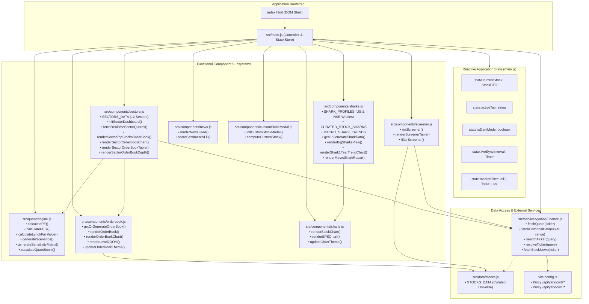
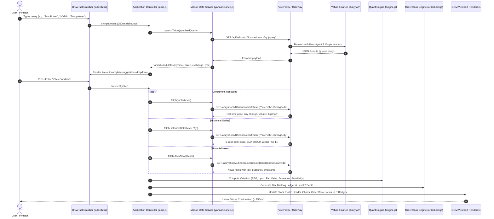
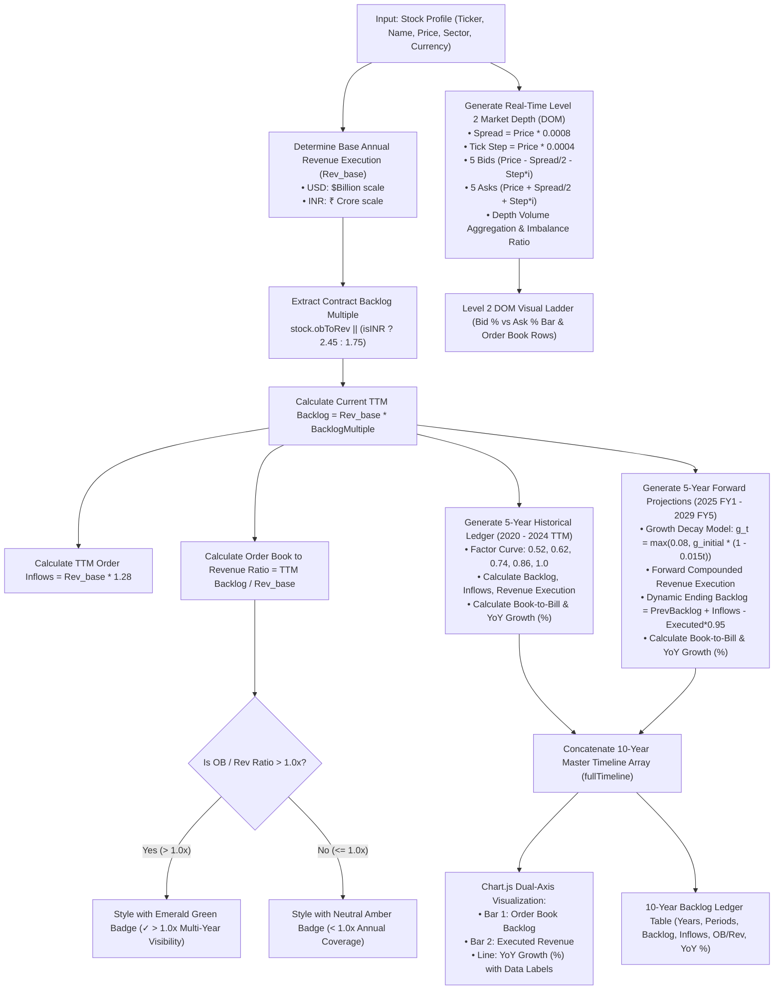
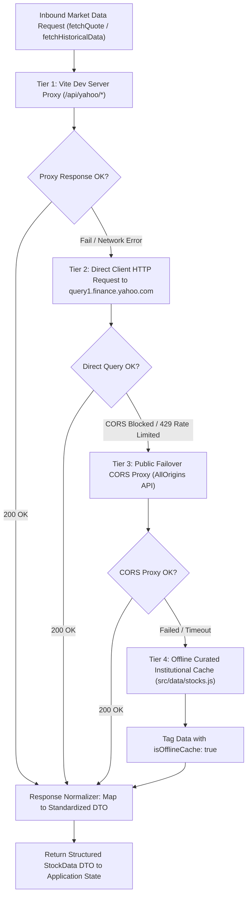

# AntiGravity — Institutional Stock Market Analysis & Quantitative Valuation Platform

[](https://opensource.org/licenses/MIT)
[](https://vitejs.dev/)
[](https://developer.mozilla.org/en-US/docs/Web/JavaScript)
[](#supported-exchanges)
[](#market-data-architecture)

**AntiGravity** is an institutional-grade financial intelligence and quantitative analysis suite. The repository houses two primary specialized terminals:

1. **[Quantitative Stock Analysis](./Quantitative%20Stock%20Analysis/)**: A high-performance web platform featuring Peter Lynch **Growth-At-A-Reasonable-Price (GARP)** valuation models, **On-Demand 10-Year Order Book Backlog History** (2020–2029) with YoY growth metrics & Level 2 Market Depth (Bids/Asks), a dedicated **Sector Rotation & Quant Leaders Dashboard** with **Full-View Mode** (auto-hiding stock card and nav tabs for maximum focus), 3-scenario stress testing, 2D sensitivity matrices, Chart.js momentum technicals, and financial NLP sentiment analysis.
2. **[Intraday Stock Picker](./Intraday%20Stock%20Picker/)**: An intraday trading terminal and momentum scanner with real-time 1-minute candle streaming, automated pattern recognition (Engulfing, Hammer, Shooting Star, RVOL volume breakouts), multi-timeframe confluence rating, and dynamic stop-loss/target calculations.

---

## 🏛️ System Architecture

### 1. High-Level Technical Architecture (HLA)

The AntiGravity platform utilizes a modern, decoupled multi-tier architecture designed for low-latency market analysis, responsive client-side evaluation, and high network resilience.

```mermaid
flowchart TD
    %% High-Level Technical Architecture of AntiGravity

    subgraph ClientPresentation ["1. Client Presentation Tier (Responsive Institutional Web & Terminal UI)"]
        TerminalShell["Quantitative Stock Analysis Shell<br/>(index.html & style.css)"]
        Omnibar["Universal Omnibar Search<br/>& Fuzzy Symbol Resolver"]
        TickerTape["Streaming Market Ticker Tape<br/>(NIFTY 50 | SENSEX | S&P 500 | NASDAQ)"]
        
        subgraph TabNavigation ["Institutional Tab Navigation System"]
            TabValuation["Peter Lynch GARP Valuation<br/>& 2D Sensitivity Matrix"]
            TabMomentum["Technical Momentum & Candlesticks<br/>(SMA 50/200, RSI 14, Pivots)"]
            TabOrderBook["Order Book & 10Y History<br/>(OB/Rev Ratio > 1.0x & Level 2 Depth)"]
            TabSharks["Big Sharks & 13F Trends<br/>(Adding/Removing, 1Y Trend & Macro Radar)"]
            TabNews["Financial News Feed<br/>& NLP Sentiment Classifier"]
            TabScreener["Global GARP Radar Screener<br/>(NSE India / US Markets)"]
            TabSectors["Sector Rotation Dashboard<br/>& Top 3 Quant Leaders"]
        end

        IntradayTerminal["Intraday Stock Picker<br/>(Lightweight Charts & Python Backend)"]
    end

    subgraph CoreEngines ["2. Application Logic & Quantitative Engine Tier (ES6+ Modules)"]
        MainOrchestrator["Application Orchestrator & State Store<br/>(src/main.js)"]
        QuantEngine["Quantitative Valuation Engine<br/>(src/quant/engine.js)<br/>• Peter Lynch Fair Value<br/>• PEG Ratio<br/>• 3-Scenario Stress Test<br/>• 2D Sensitivity Matrix"]
        SectorEngine["Sector Rotation & Screener Engine<br/>(src/components/sectors.js)<br/>• YTD Performance Ranking<br/>• Top 3 Quant Leaders Isolation<br/>• Market Filter (NSE / US / Global)"]
        OrderBookEngine["Contract Backlog & Order Book Engine<br/>(src/components/orderbook.js)<br/>• 10-Year Backlog Ledger (2020-2029)<br/>• OB / Revenue Ratio (> 1.0x Green)<br/>• Level 2 Market Depth Simulator"]
        SharkEngine["Big Sharks & 13F Flow Engine<br/>(src/components/sharks.js)<br/>• Marquee Whales Roster (US & NSE)<br/>• 1Y Inflow/Outflow Dual-Axis Flow<br/>• Macro Accumulation & Dump Radar"]
        ChartEngine["Visualizations & Rendering Engine<br/>(src/components/charts.js)<br/>• Chart.js Dual-Axis Renderers<br/>• YoY Growth DataLabels Plugin"]
        NewsEngine["Financial NLP Sentiment Classifier<br/>(src/components/news.js)"]
        ScreenerEngine["GARP Radar Screener Controller<br/>(src/components/screener.js)"]
        IntradayEngine["Intraday Momentum Engine<br/>(Intraday Stock Picker/analysis_engine.py)"]
    end

    subgraph GatewayTier ["3. API Gateway & Network Resilience Tier"]
        DevProxy["Vite Reverse Proxy Middleware<br/>(vite.config.js)<br/>• /api/yahoo/v8/finance/chart/*<br/>• /api/yahoo/v1/finance/search/*<br/>• Header Spoofing & CORS Bypass"]
        DataService["Market Data Service<br/>(src/services/yahooFinance.js)<br/>• Multi-Tier Fallback Orchestrator<br/>• Symbol Resolver & Sanitizer<br/>• Response Normalizer & DTO Mapper"]
        CORSProxy["Public CORS Failover Proxies<br/>(AllOrigins / CorsProxy.io)"]
        BaselineStore["Offline Institutional Baseline Cache<br/>(src/data/stocks.js)"]
    end

    subgraph ExternalFeeds ["4. External Market Data & Exchange Feeds"]
        YahooAPI["Yahoo Finance Streaming Query APIs<br/>• Real-time Quotes & Tickers<br/>• 1Y Daily Price Candles<br/>• Curated Financial News Feed"]
        Exchanges["Global Stock Exchanges<br/>• NSE India (.NS / .BO)<br/>• US Markets (NASDAQ / NYSE)"]
    end

    %% Data Flow Connections
    Omnibar -->|"Search Query / Enter"| MainOrchestrator
    MainOrchestrator -->|"Fetch Quote / History"| DataService
    DataService -->|"Tier 1: Proxy Request"| DevProxy
    DevProxy -->|"HTTP GET (Streaming)"| YahooAPI
    DataService -.->|"Tier 2: Failover (Direct / CORS)"| CORSProxy
    CORSProxy -.->|"Forward Query"| YahooAPI
    DataService -.->|"Tier 3: Offline Fallback"| BaselineStore
    YahooAPI --- Exchanges

    DataService -->|"Normalized Stock DTO"| MainOrchestrator
    MainOrchestrator -->|"Stock Profile"| QuantEngine
    MainOrchestrator -->|"Stock Profile"| OrderBookEngine
    MainOrchestrator -->|"Stock Profile & Price"| SharkEngine
    MainOrchestrator -->|"Constituents & Benchmarks"| SectorEngine
    MainOrchestrator -->|"Historical Daily Series"| ChartEngine
    MainOrchestrator -->|"Raw News Headlines"| NewsEngine

    QuantEngine -->|"Valuation Models & Scenarios"| TabValuation
    ChartEngine -->|"Momentum Visualizations"| TabMomentum
    OrderBookEngine -->|"10Y History & Level 2 Depth"| TabOrderBook
    SharkEngine -->|"Whale Flows, 1Y Trend & Radar"| TabSharks
    NewsEngine -->|"NLP Scored News Stream"| TabNews
    ScreenerEngine -->|"Live GARP Grid"| TabScreener
    SectorEngine -->|"Ranked Sectors & Top 3 Picks"| TabSectors
```



#### Layer-by-Layer Architectural Responsibilities:

| Tier | Primary Responsibilities | Core Technologies |
| :--- | :--- | :--- |
| **1. Client Presentation Tier** | Renders high-contrast dark/light glassmorphism UI, universal omnibar search, streaming ticker tape, and 6 interactive analytical views. Dispatches user interaction events to the orchestrator. | HTML5, Vanilla CSS Design System, Lucide SVG Icons |
| **2. Core Application Engines Tier** | Computes quantitative valuations (PEG, Peter Lynch Fair Value, 3-Scenario stress tests), generates 10-year order book timelines with YoY growth %, simulates Level 2 market depth, calculates sector rotation rankings, tracks Big Sharks & institutional fund manager positions with 1-year flow trends, and scores financial news headlines. | ES6+ Vanilla JavaScript Modules, Chart.js 4.x |
| **3. API Gateway & Resilience Tier** | Bypasses CORS and origin restrictions via Vite development middleware, manages User-Agent headers, routes live streaming quote and historical candle requests, and executes multi-tier failovers. | Vite Node.js Proxy, Fetch API, Failover Handlers |
| **4. External Market Feeds Tier** | Authoritative market data source supplying real-time stock quotes, bid/ask ticks, 1-year daily candlestick series, and breaking corporate news across NSE India and US exchanges. | Yahoo Finance Query APIs (v8 Chart, v1 Search, v6 Quote) |

---

### 2. Low-Level Technical Architecture (LLA)

The Low-Level Architecture details the internal module structure, algorithmic pipelines, data flow lifecycles, and interface schemas governing system execution.

#### 2.1 Component & Module Dependency Hierarchy



#### 2.2 Universal Omnibar Search & Fuzzy Resolution Pipeline



#### 2.3 Sector Rotation & Quant Leader Screening Pipeline

```mermaid
flowchart TD
    %% Sector Rotation and Screening Workflow

    StartSector["User Selects 'Sector Dashboard' (Top Nav Header)"] --> ModeSwitch["Enter Sector Full-View Mode:<br/>• Add body.view-sector-dashboard<br/>• Hide Stock Card (#stockHeroCard)<br/>• Hide Stock Nav Tabs (.nav-tabs)<br/>• Display Sector View Header with 'Back to Stock Terminal'"]
    
    ModeSwitch --> LoadSectors["Load 12 Primary Sectors (SECTORS_DATA)"]
    LoadSectors --> FetchQuotes["Concurrent Batch Fetch: Real-Time Quotes for Benchmarks & Constituents"]
    FetchQuotes --> CalcYTD["Compute Real-Time Sector YTD Returns (%)"]
    CalcYTD --> SortSectors["Sort Sectors Descending by YTD Change (Alpha to Laggard)"]
    SortSectors --> RenderChart["Render Horizontal Ranked Bar Chart (Green > 0%, Red < 0%)"]
    RenderChart --> RenderGrid["Render 12 Sector Cards with Constituent Stock Chips"]

    FilterCheck{"User Selected Market Filter?"}
    RenderGrid --> FilterCheck
    FilterCheck -->|"All Markets 🌐"| UniverseAll["Evaluate All Global Constituents"]
    FilterCheck -->|"NSE India 🇮🇳"| UniverseNSE["Filter Constituents Ending with .NS / .BO"]
    FilterCheck -->|"US Equities 🇺🇸"| UniverseUS["Filter US Tickers (NASDAQ / NYSE)"]

    UniverseAll --> QuantScreen["Institutional Multi-Factor Quant Screening Algorithm"]
    UniverseNSE --> QuantScreen
    UniverseUS --> QuantScreen

    QuantScreen --> SelectTop3["Isolate Top 3 Quant-Screened Leader Stocks"]
    SelectTop3 --> RenderTop3Cards["Render Top 3 Leader Cards:<br/>• Quant Score & GARP Badges<br/>• Inline Backlog & OB/Rev Multiple<br/>• 'View 10-Year Order History & Depth ↓' Button"]

    RenderTop3Cards --> OBCheck{"User Clicks 'View 10-Year Order History & Depth'?"}
    OBCheck -->|"Not Clicked (Default)"| OBHidden["Keep #sectorOrderBookSection Hidden (display: none)"]
    OBCheck -->|"Button Clicked for Stock"| ShowOB["Open Sector Order Book for Clicked Stock:<br/>• activeSectorObTicker = stock.ticker<br/>• display: block with smooth scroll<br/>• Button updates to 'Viewing 10-Year Order History ✓'<br/>• Stock Tabs (#1, #2, #3, Compare All 3)<br/>• 10-Year Bar Chart (Backlog vs Revenue + YoY % Line)<br/>• 10-Year Backlog Ledger Audit Table<br/>• Real-Time Level 2 Market Depth (Bids vs Asks)<br/>• 'Hide Order Book' Close Button"]

    ShowOB --> UserExit{"User Exits to Stock Terminal?"}
    OBHidden --> UserExit
    UserExit -->|"Clicks 'Back to Stock Terminal' / Top Nav Toggle / 'Analyze in Terminal' / Omnibar Search"| RestoreStockView["Exit Sector Full-View Mode:<br/>• Remove body.view-sector-dashboard<br/>• Restore Stock Card & Nav Tabs<br/>• Load Selected Stock View (tab-return-model)"]
```



#### 2.4 Order Book & 10-Year Backlog Engine Architecture



#### 2.5 Resilient Multi-Tier Market Data Ingestion Pipeline



---

### 3. Core Data Contracts & Interface Schemas

```typescript
// Standardized Stock Data Transfer Object (DTO)
interface StockData {
  ticker: string;                     // e.g. "NVDA", "TATAPOWER.NS"
  name: string;                       // e.g. "NVIDIA Corporation"
  price: number;                      // Current market price
  change: number;                     // Absolute price change today
  changePercent: number;              // Percentage price change today
  currency: 'USD' | 'INR';            // Currency denomination ('$' | '₹')
  exchange: string;                   // "NASDAQ", "NSE", "NYSE"
  marketCap: number;                  // Capitalization in base currency
  pe: number;                         // Forward Price-to-Earnings ratio
  eps: number;                        // Forward Earnings Per Share
  growthRate: number;                 // Annualized EPS growth rate (decimal, e.g. 0.28)
  peg: number;                        // Price/Earnings-to-Growth ratio
  lynchFairValue: number;             // Peter Lynch calculated intrinsic fair value
  fairValueUpside: number;            // Percentage upside to fair value
  quantScore: number;                 // Composite quantitative score (0 - 100)
  orderBook?: OrderBookData;          // Attached order book & backlog dataset
}

// 10-Year Order Book Backlog Ledger Entry
interface OrderBookLedgerEntry {
  year: string;                       // "2020", "2024 (TTM)", "2029 (FY5)"
  period: 'Historical' | 'Projected'; // Period classification
  backlog: number;                    // Ending contract work-in-hand
  inflows: number;                    // New commercial contract bookings
  execution: number;                  // Revenue recognized from backlog
  bookToBill: number;                 // Inflows / Execution ratio
  obToRev: number;                    // Backlog / Execution ratio
  growth: number;                     // Year-over-Year Growth in %
}

// Order Book & Contract Backlog Model
interface OrderBookData {
  unit: string;                       // "$B" | "₹ Cr"
  curr: string;                       // "$" | "₹"
  currentBacklog: number;             // Current backlog magnitude
  currentBacklogFormatted: string;    // e.g. "$168.5B", "₹1,07,800 Cr"
  orderBookToRevenue: number;         // Ratio: Backlog / Annual Revenue
  bookToBill: number;                 // Ratio: Inflows / Execution
  revenueVisibilityYears: number;     // Backlog / Annual Revenue (Years)
  forwardCAGR: number;                // 5-Year forward backlog CAGR %
  inflowRunRateFormatted: string;     // Annual inflow run rate
  historical5Y: OrderBookLedgerEntry[]; // 2020 - 2024 TTM (5 Years)
  projected5Y: OrderBookLedgerEntry[];  // 2025 FY1 - 2029 FY5 (5 Years)
  fullTimeline: OrderBookLedgerEntry[]; // Concatenated 10-Year Ledger
  level2Depth: Level2Depth;           // Real-time market depth book
}

// Level 2 Market Depth (Bids vs Asks) Book
interface Level2Depth {
  spread: number;                     // Absolute bid-ask spread
  spreadPercent: number;              // Spread as percentage of price
  bidTotal: number;                   // Total cumulative bid shares
  askTotal: number;                   // Total cumulative ask shares
  bidPercent: number;                 // Bid depth percentage (e.g. 58%)
  askPercent: number;                 // Ask depth percentage (e.g. 42%)
  imbalanceRatio: number;             // BidTotal / AskTotal
  bids: Array<{ price: number; size: number; orders: number }>;
  asks: Array<{ price: number; size: number; orders: number }>;
}
```

---

## 📁 Repository Directory Structure

```
AntiGravity/
├── README.md                      # Root Master Technical Architecture & System Documentation
├── Quantitative Stock Analysis/   # Institutional Quantitative Equity Platform
│   ├── index.html                 # Terminal UI Shell and Semantic Viewports
│   ├── package.json               # Dependencies and build scripts
│   ├── vite.config.js             # Vite Configuration & Yahoo Finance API Reverse Proxy
│   ├── README.md                  # Quantitative Stock Analysis Detailed Documentation
│   └── src/
│       ├── main.js                # App Controller, State Store, Omnibar Search Handler
│       ├── style.css              # Institutional Dark/Light CSS Theme & Design System
│       ├── components/
│       │   ├── charts.js          # Chart.js Technical & Fundamental Charts
│       │   ├── orderbook.js       # 10Y Backlog Ledger Engine & Level 2 DOM Depth
│       │   ├── sectors.js         # Sector Rotation, Top 3 Quant Leaders, Market Filters
│       │   ├── screener.js        # GARP Radar Screener Table with Multi-Sorting
│       │   ├── news.js            # Financial News Feed & NLP Sentiment Classifier
│       │   └── customStockModal.js# Custom Stock Valuation Sandbox Modal
│       ├── data/
│       │   └── stocks.js          # Curated Universe & Baseline Data (NSE & US)
│       ├── quant/
│       │   └── engine.js          # Quantitative Valuation Engine (PEG, Fair Value, Scenarios)
│       └── services/
│           └── yahooFinance.js    # Multi-Tier Resilient Market Data Ingestion
│
└── Intraday Stock Picker/         # Intraday Momentum Screener & Technical Setup Engine
    ├── app.py                     # FastAPI API Server & Web Endpoint Orchestrator
    ├── analysis_engine.py         # Multi-Timeframe Trend & Pattern Recognition Engine
    ├── data_fetcher.py            # Real-time 1-Minute Live Data Pipeline via yfinance
    ├── requirements.txt           # Python Dependencies
    └── README.md                  # Intraday Stock Picker Documentation
```

---

## 🚀 Quick Start Guide

### 1. Launching Quantitative Stock Analysis (Web Platform)

```bash
cd "Quantitative Stock Analysis"
npm install
npm run dev
```
Navigate to `http://localhost:5173` to access the terminal.

To produce an optimized production bundle:
```bash
npm run build
```

### 2. Launching Intraday Stock Picker (Intraday Terminal)

```bash
cd "Intraday Stock Picker"
pip install -r requirements.txt
python app.py
```
Navigate to `http://localhost:5000` to access the intraday terminal.

---

## 🌍 Supported Exchanges

- **NSE (National Stock Exchange of India)**: Ticker suffix `.NS` (e.g. `TATAPOWER.NS`, `BEL.NS`, `RELIANCE.NS`, `TCS.NS`, `SBIN.NS`). Currency displayed in INR (`₹`).
- **BSE (Bombay Stock Exchange)**: Ticker suffix `.BO` (e.g. `TATAPOWER.BO`).
- **NASDAQ (United States)**: (e.g. `NVDA`, `AAPL`, `MSFT`, `TSM`, `AMZN`, `GOOGL`, `TSLA`). Currency displayed in USD (`$`).
- **NYSE (New York Stock Exchange)**: (e.g. `PLTR`, `BABA`, `RTX`, `JPM`).

---

## 📄 License

This project is licensed under the [MIT License](LICENSE).
