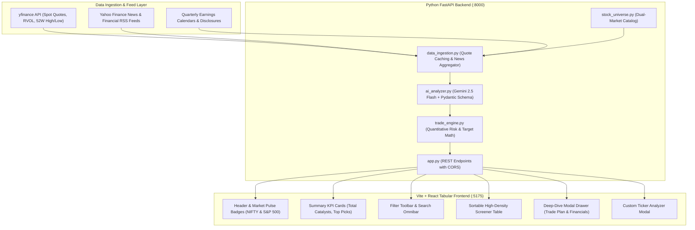

# Stock Catalyst & Earnings Screener 🎯

> **Automated AI-Driven Stock Recommendation Web Application for Breaking News & Quarterly Results**  
> Identifies asymmetric trade opportunities across **Indian (NSE/BSE)** and **US (NYSE/NASDAQ)** markets for **Immediate Next-Day Intraday Moves (+2% to +6%)** and **Short-Term Delivery Breakouts (+10% to +50% Return)**.

---

## 📌 Executive Summary

**Stock Catalyst Screener** is an institutional quantitative and AI-driven equity research platform designed to monitor breaking financial news, regulatory circulars, and quarterly earnings disclosures.

The application pairs real-time price discovery via `yfinance` with the **Google Gemini API** (via LangChain / `google-genai`) to evaluate the conviction and magnitude of market catalysts. For every identified setup, the system algorithmically generates institutional execution parameters including **Entry Price**, tight **Stop Loss**, tiered **Target Prices**, and favorable **Risk:Reward ratios**.

All recommendations are presented in an institutional, high-density **Tabular Screener UI** with column sorting, live market status, and interactive deep-dive drawers.

---

## 🌟 Key Features

### 1. Dual-Market Coverage (Dalal Street & Wall Street)
* **🇮🇳 Indian Equities (NSE/BSE)**: Top Nifty 50, Bank Nifty, and high-beta midcaps (`RELIANCE`, `TCS`, `HDFCBANK`, `TATAMOTORS`, `INFY`, `DIXON`, `HAL`, `BEL`, `TRENT`, `SUZLON`, `POLYCAB`, `BSE`, `CDSL`, etc.).
* **🇺🇸 US Equities (NYSE/NASDAQ)**: Mega-cap tech, AI infrastructure, and high-beta growth momentum (`NVDA`, `AAPL`, `MSFT`, `TSLA`, `AMD`, `PLTR`, `SMCI`, `COIN`, `CRWD`, `LLY`, `AMZN`, `GOOGL`, `META`, etc.).

### 2. Multi-Horizon Recommendation Engine
* **⚡ Next-Day Intraday Momentum (+2% to +6% Target)**:
  - Tight risk invalidation stop loss (1.2% to 1.6%).
  - Fast Opening Range Breakout (ORB) entry buffer.
  - Favorable Risk:Reward ratio ($\ge 1 : 2.0$).
* **🚀 Short-Term Delivery / Swing (+10% to +50% Expected Return)**:
  - Captures Post-Earnings Announcement Drift (PEAD) and structural re-ratings over 1 to 4 weeks.
  - Asymmetric reward scaling (+12% to +48%) anchored to swing supports.
  - High asymmetric Risk:Reward ratio ($1 : 3.0$ to $1 : 7.5$).

### 3. Gemini AI Catalyst & Heuristic Analysis
* **Strict Pydantic JSON Output**: Evaluates news impact, earnings beats/misses, forward guidance revisions, and order wins into structured models.
* **Resilient Heuristic Fallback**: Includes a deterministic quantitative rule engine that runs seamlessly even without an external API token or during network limits.

### 4. Institutional Tabular Screener UI (Vite + React)
* **High-Density Table View**:
  - Columns: **Ticker**, **Market (India/US)**, **Direction (Buy/Sell)**, **Timeframe (Intraday/Short-term)**, **Reason**, **Current Price (LTP)**, **Entry Price**, **Stop Loss Price**, **Target Price**, **Risk:Reward**, and **AI Conviction Score**.
* **Interactive Column Sorting**: Click-to-sort on all numeric and alphabetical headers (Ascending/Descending toggle, sort indicator icons, `aria-sort`).
* **Multi-Criteria Filter Toolbar**: Quick toggles for Market (`All`, `India`, `US`), Timeframe (`All`, `Intraday`, `Short-term`), Direction (`All`, `BUY`, `SELL`), and real-time Search Omnibar.
* **Deep-Dive Catalyst Modal**: View verbatim news headlines, publishing sources, quarterly financial scorecards (Revenue, PAT, Margins), and a 1-click **"Copy Trade Plan"** button.
* **On-Demand Ticker Analyzer**: Modal enabling instant AI catalyst analysis on any user-entered stock ticker.

---

## 🏛️ System Architecture



---

## 📁 Project Directory Structure

```
Stock Catalyst Screener/
├── .env.example                     # Sample API keys (GEMINI_API_KEY, PORT)
├── README.md                        # Project documentation and architecture guide
├── start.sh                         # 1-Click launcher for both Backend and Frontend
├── backend/
│   ├── app.py                       # FastAPI REST API endpoints (/api/catalysts, /api/markets, /api/scan)
│   ├── ai_analyzer.py               # Gemini AI prompt engine & quantitative heuristic fallback
│   ├── data_ingestion.py            # yfinance live quote fetcher, news parser & curated catalysts
│   ├── trade_engine.py              # Quantitative Entry, Stop Loss, Target, and R:R calculator
│   ├── stock_universe.py            # Curated catalog for Indian (NSE) and US (NYSE/NASDAQ) stocks
│   ├── requirements.txt             # Python dependencies
│   └── test_backend.py              # Automated unit tests for trade math, schemas, and stock universe
└── frontend/
    ├── package.json                 # React 18, Vite 6, and Lucide-react dependencies
    ├── vite.config.js               # Vite configuration with /api backend proxy
    ├── index.html                   # HTML shell with Google Fonts (Inter, Outfit, JetBrains Mono)
    └── src/
        ├── App.jsx                  # Main application state and layout
        ├── main.jsx                 # React DOM mount point
        ├── style.css                # Institutional Bloomberg-style dark design system
        └── components/
            ├── Header.jsx           # App branding, live market chips, and custom ticker button
            ├── DisclaimerBanner.jsx # Mandatory regulatory non-advisory compliance banner
            ├── SummaryCards.jsx     # Top KPI overview cards
            ├── FilterToolbar.jsx    # Market, timeframe, direction, and search omnibar
            ├── CatalystTable.jsx    # High-density sortable tabular screener
            ├── CatalystModal.jsx    # Deep-dive drawer with news verbatim & "Copy Plan"
            └── TickerAnalyzerModal.jsx # On-demand custom ticker analysis modal
```

---

## 🚀 Getting Started

### Prerequisites
* **Python 3.10+**
* **Node.js 18+** and **npm 9+**

### 1-Click Launch (Recommended)
Run the automated launcher script to start both backend and frontend servers simultaneously:
```bash
./start.sh
```
* **Frontend UI**: Open [http://localhost:5175/](http://localhost:5175/)
* **Backend API Docs**: Open [http://localhost:8000/docs](http://localhost:8000/docs)

---

### Manual Setup & Execution

#### 1. Backend Setup
```bash
cd backend

# (Optional) Create and activate a virtual environment
python3 -m venv .venv
source .venv/bin/activate

# Install dependencies
pip install -r requirements.txt

# Run automated verification tests
python3 test_backend.py

# Launch FastAPI backend server
uvicorn app:app --host 0.0.0.0 --port 8000 --reload
```

#### 2. Frontend Setup
In a separate terminal:
```bash
cd frontend

# Install client packages
npm install

# Start Vite React dev server
npm run dev
```
Open **[http://localhost:5175/](http://localhost:5175/)** in your browser.

---

## 🔑 Environment Configuration

Create a `.env` file in the project root or `backend/` directory by copying `.env.example`:
```bash
cp .env.example .env
```
Populate with your optional API keys:
```env
# Optional: Google Gemini API Key for LLM processing
GEMINI_API_KEY=your_actual_key_here

# Backend Port
BACKEND_PORT=8000
```
> **Note**: Even without a `GEMINI_API_KEY`, the application automatically uses its built-in quantitative heuristic engine, guaranteeing 100% operational functionality out of the box!

---

## 🔒 Regulatory & Financial Disclaimer
This application is strictly for **educational, analytical, and research purposes**. All trade setups, price targets, stop losses, and directional biases are generated by algorithms and artificial intelligence. This platform is **not a registered SEBI, SEC, or FINRA financial advisory firm**. Users should always perform their own due diligence and consult a certified financial advisor before committing capital to financial markets.
